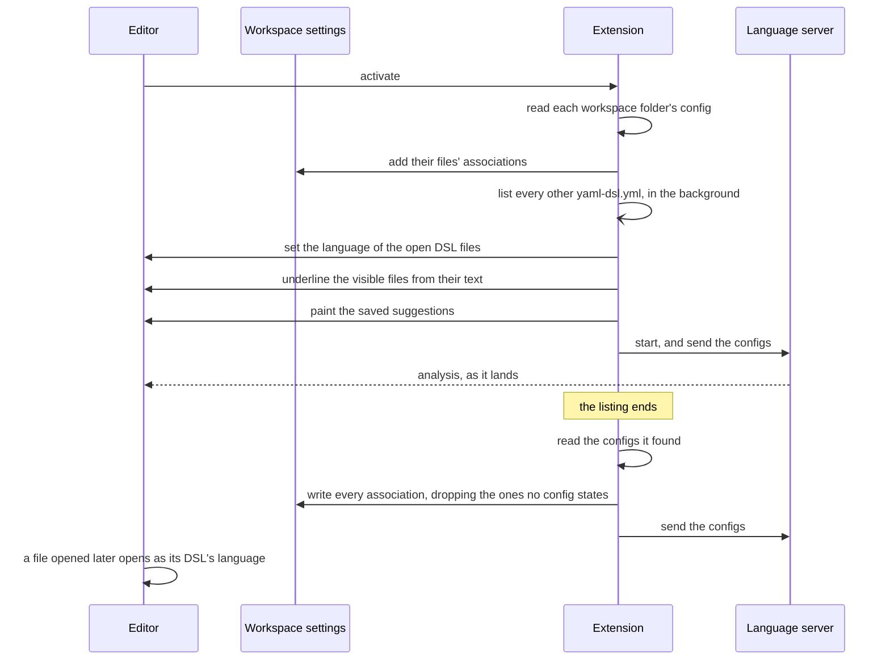
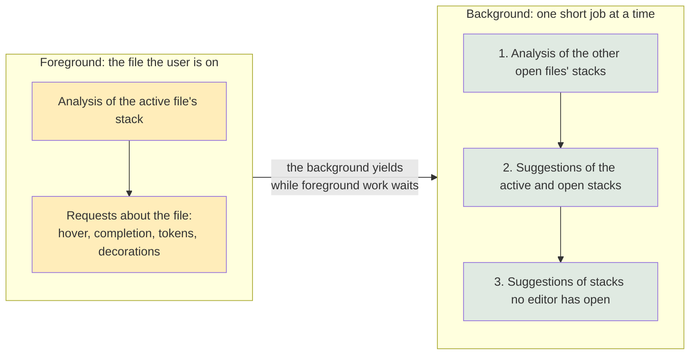
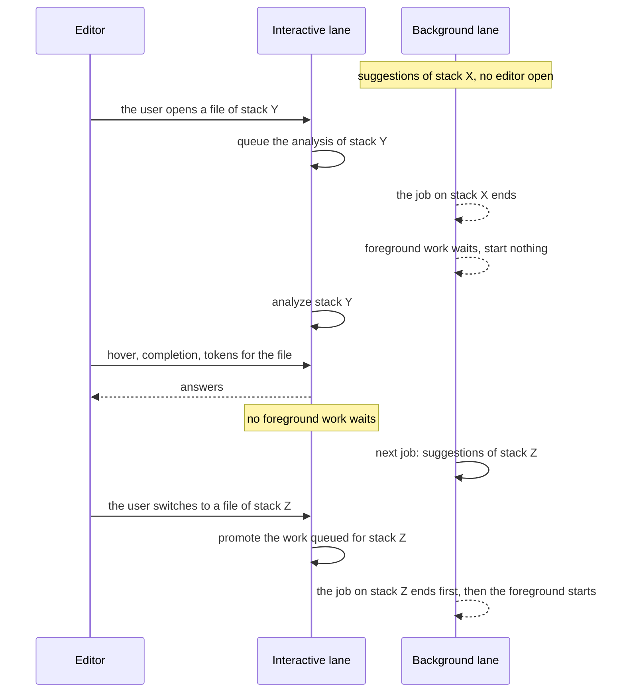
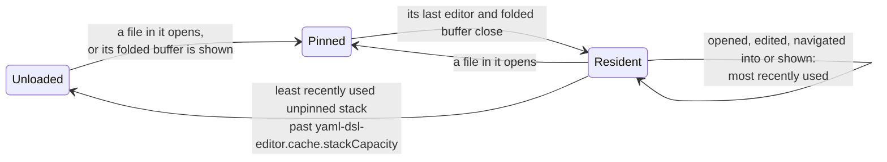
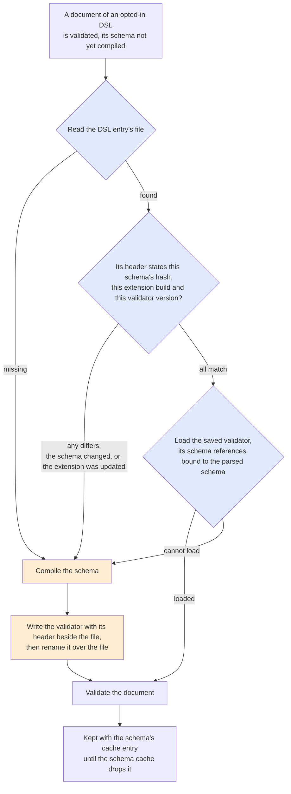
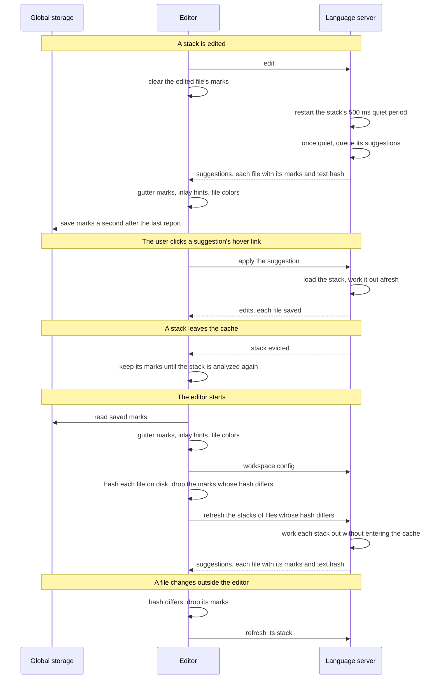

# YAML DSL editor

Authoring `mock-dsl.yml` is hard without this extension:

- A stack is a common layer and its overlays. The file on screen is one of those, not an overlay's full config.
- A field's documentation sits beside a `$ref` the usual YAML tooling never reads.
- A `ref` and a `local` are strings, so nothing jumps to the declaration.

The extension is the editor that makes that document authorable.

## Generic by config

Any DSL written this way is a block in the workspace config, `yaml-dsl.yml`. Nothing about a particular DSL is compiled into the extension, and the config states every rule: the extension has no defaults, because every DSL is different. A DSL's block states:

- which files belong;
- its scopes;
- where names are declared, and how they are referenced;
- its placeholders and functions;
- when the DSL has layers, which directories are overlays;
- a fallback schema for a document that names none.

Scopes, references, placeholders and calls are generic: the editor validates, navigates, completes and hovers them the same way in every DSL. Each DSL's block supplies the syntax, and those syntaxes differ.

`mock-dsl.yml` is the DSL this document works through:

- Its field types are shared definitions, because a value may be a scalar, a `ref`, or a bare `local`.
- A simpler DSL uses the same engine through its own config block.
- It is the first config block, and its files are the first the editor is proven against.

Features are tuned iteratively. The first slice is what any editor for a programming language provides: hover documentation, and navigation of refs and locals. Diffing overlays, suggestions and extraction into the common layer follow, tuned the same way.

## Language server

The editor is a language server. Activating any `mock-dsl.yml` puts the whole stack in scope, the common layer and every adjacent overlay, and the server holds that context:

- Switching from one file of the stack to another uses it; rebuilding the stack on each switch would be slow.
- It keeps the stack current as the files change, the folded document of each overlay included.
- The folded documents are buffers in the editor view, so the author sees an overlay's full config instead of assembling it from the files.
- Hover and navigation run against the stack in scope, not against the active file alone.

### Analysis

On each change the server parses the changed YAML, reads that file's schema, and resolves references, placeholders and calls across the stack. Hover and navigation are requests against that analysis; problems and suggestions are further results of the same pass.

A problem has a severity, drawn in the color the DevOps tools print it in:

| Severity | At its range | In the gutter | Color |
|---|---|---|---|
| error | red text and a red squiggle | the error mark | the failure red |
| warning | its own mark, such as a struck-through key | a triangle | the warning yellow |
| info | a wavy underline, the text unchanged | the info mark | the info blue |

- A problem shows its message on hover.
- An empty range covers its whole line.
- The gutter marks share one size.
- An info problem is a schema the file names that cannot be loaded.
- A validation error takes the severity its setting names.
- The validation errors on one key share one hover: a `validation errors` heading in bold, in the theme's `validationErrorsHeadingForeground`, and each error a bullet.
- Every warning but a deprecation is underlined in yellow.

Keys:

| Problem | Severity | Message |
|---|---|---|
| a key with no `:` yet | error, on that key only | `` `<key>` needs a `:` `` |
| a key its map holds more than once | warning, every copy's key underlined in yellow | `` `<key>` is also at line <n> `` |

- A key with no `:` is no error while the cursor is on its line; the error shows once the cursor leaves it.
- The lines around a key with no `:` are read as if the key were not there.

### Startup

The extension is an editor first, and nothing it does holds back the file. Its first act on startup is to claim the DSL files, before anything else reads them:

1. It reads each workspace folder's own config and writes its files' associations, so a file opened from then on opens as its DSL's language.
2. It lists every other `yaml-dsl.yml` in the background, and writes their associations once they are read.

Then, on startup and for every newly opened file:

1. The file opens as its DSL's language at once, colored by the grammar, its references underlined from the text.
2. The suggestions saved from earlier sessions paint next, from the one file that keeps them.
3. Analysis starts in the background, and its classes, problems and suggestions paint as they land.



The workspace holds many stacks. The server loads one when a file in it is first opened, and loads no other. A resident stack is the parsed common layer, every adjacent overlay, the symbol index, and the folded document of each overlay. Switching files inside a resident stack is a hit.

### Processing model

The work splits into the foreground, the file the user is on, and the background, everything else. The foreground always comes first.

| | Foreground | Background |
|---|---|---|
| Work | the active file's stack: its analysis, and every request about the file | the other open files' stacks, then the suggestions of the active and open stacks, then the suggestions of stacks no editor has open |
| Starts | at once | only while no foreground work waits |
| Runs in the language server | the interactive lane | the background lane, one job at a time, highest priority first |



Interruption and refocus:

- A background job is short: one stack's analysis, or one stack's suggestions.
- Between two jobs the background lane yields, and while any foreground work waits it starts none.
- Opening a file, or switching to one, makes its stack the foreground: work already queued for it is promoted, and its analysis starts at once.
- Only a job holding the same stack makes the foreground wait, and only until that job ends.
- A request about a file is answered once that file's analysis is done.



The staleness checks are what starts work, and nothing else does.

On the client, a report costs one pass:

- Applying a report to the kept suggestions rebuilds, once, the marks painted in the editors and the file and folder sets the Explorer reads.
- The Explorer asks about every file and folder it shows, so each answer is one lookup in those sets.
- The extension's settings are read once, and again only when they change.

### Stack cache

The cache is bounded, and the unit is the stack:

- A stack with a file in an open editor is pinned, and so is a stack whose folded buffer is on screen. A pin is never evicted.
- Opening, editing, navigating into or showing a stack marks it most recently used. Background work is not use: rebuilding stacks after a config change keeps their places.
- Capacity beyond the pins is the setting `yaml-dsl-editor.cache.stackCapacity`.
- Loading a stack past that, or lowering the setting, evicts the least recently used unpinned stack: its analysis is dropped and its folded buffers close. The files on disk stay, and the next activation loads the stack again.
- A change to a resident stack updates it in place.



### Schema cache

A stack's schema is the `schema.json` of the grammar version that stack initialized:

- The same grammar version is the same schema, so every stack on that version shares one parsed copy.
- A different grammar version is a different schema, however small the difference, and hover for a stack uses its own version's schema.
- The cache's unit is the distinct schema, one entry per hash. Bytes identical to a schema the server holds are that schema and are not parsed again.
- A schema a resident stack uses is pinned. Capacity beyond the pins is the setting `yaml-dsl-editor.cache.schemaCapacity`; past it, the least recently used schema is dropped.
- Evicting a stack unpins the schemas only it used.
- What the extension works out from a schema, such as the node fingerprints and validators of the schema checks, belongs to the schema's entry and goes with it.
- A modeline's fragment names a node of the schema it reads: the schema is cached once by its text, and the fragment is kept with the reading file, never as a cache entry of its own.

A DSL's `performance` block states how the editor keeps a large schema fast:

| Field | What it states |
|---|---|
| `compiled_schema_cache` | whether the DSL's compiled schema is kept in the extension's storage and loaded in later sessions instead of compiled |

- A kept compiled schema is one file per DSL entry, stating the schema's hash, the extension's build and the validator library's version.
- The validating worker loads it when all three match. When any differs, or the file cannot be loaded, the worker compiles the schema and saves over the file.
- The saved validator refers to the nodes of the schema the worker holds, so a failure names the same schema nodes as a fresh compile.
- A save writes a new file and renames it over the old one, so a reader finds the whole of one compile or the other.



### Staleness checks

What the extension holds is a copy of what the files say: a resident stack's analysis, and a file's kept suggestions. Each copy is checked against its source on these triggers, every input takes effect without reloading the window, and every change to the extension keeps them:

| Trigger | Checked | Then | Lane |
|---|---|---|---|
| a file of a stack that is not resident is opened, or becomes active | on the open | the stack is loaded and analyzed | foreground |
| a layer file is edited in an editor | on the edit | the stack is analyzed again in place, its suggestions once the quiet period ends, and the file's painted marks are cleared until the next report | foreground, then background |
| a layer file of a resident stack changes on disk while no editor has it open | on the change | the file is read again | background |
| a layer file is deleted from disk | on the deletion | the file leaves the stack, even while an editor holds it with no unsaved edits, and comes back when it returns to disk | background |
| a layer file's editor closes | on the close | the file is read from disk again, so discarded edits, or a file gone from disk, leave the stack with what the disk holds | background |
| a path a resident file's schema search reads changes on disk | on the change | that file's schema reloads, its stack is analyzed and validated again, and its hover documentation reads the new schema, the common layer's for that overlay; a schema on disk changes when its stack is initialized again | background |
| an overlay's schema reloads | on the reload | the common layer's validation errors are worked out again, each naming exactly the overlays whose current schema its value fails | background |
| a `yaml-dsl.yml` is saved, created or deleted, or a workspace folder is added or removed | on the change | the configs reload; every resident stack is analyzed again under them, and a stack they no longer claim is dropped | background |
| a file's text on disk differs from the hash its kept suggestions were worked out from | at startup, and when the file changes on disk | its kept suggestions are dropped, and its stack is worked out again without entering the cache | background |
| the schema a file reads differs from the hash its kept suggestions were worked out against | at startup, and when the schema changes on disk | its kept suggestions and validation error mark are dropped, and its stack is worked out again without entering the cache | background |
| another build of the extension worked out a file's kept suggestions | at startup | they are never shown, and the stack of each such file still on disk is worked out again | background, last |

These hold through every change:

- A stack never opened, and with nothing kept, is never processed.
- Hover documentation is worked out on each request from the schema loaded now; a schema's parser, validator and renderer are kept with that schema and leave with it.
- A save, or a change that edits no text, keeps a file's suggestions and its painted marks.
- An evicted stack's kept suggestions stay shown until the stack is analyzed again.
- A click on a kept suggestion works its stack out afresh before writing anything.
- An extension setting change applies at once, and reworks no stack.
- Terraform's function metadata is read once per session.

### Output

The YAML DSL output channel exists from activation and logs:

- each startup step;
- the build of the extension it runs;
- the first analysis of each opened file, with its time;
- every failure.

A startup step that fails is logged and skipped, so the language server always starts and the file always shows.

### Boundaries and tests

- The server does not run the engine. The continuous compile is the editor's analysis; plan and admission stay with the engine.
- The extension process is the client. The analysis is a plain module with no editor API in it, tested on its own with `node --test`. Editor features stay in the language server.
- Line coverage and branch coverage of the extension's own code are each at least 90%. The `node --test` run measures both and fails if either is under that; test files are not part of the measured set.

## Common layer and overlays

A layered DSL's stack is one common layer and its overlays. The engine deep-merges the common layer under the overlay at the common layer's root, and the folded document is what a plan sees.

`layers.common_layer_discovery` states how an overlay and its common layer are paired:

| Value | The pairing | The common layer's root |
|---|---|---|
| `parent` | an overlay directory holds the overlay itself, its parent the common layer | `$` |
| `ancestor` | the overlay may sit deeper, at the same path below the overlay directory in every overlay | `$` |
| `overlay_includes` | an include in the overlay names the common layer | the map holding the include |

For `parent` and `ancestor`:

- Each overlay is a `mock-dsl.yml` under an overlay directory, one `layers.overlay_folders` names, such as `overlay-1` or `overlay-2`, directly below the common layer's directory.
- A file below no overlay directory is a common layer.

| Value | The overlay file | Example |
|---|---|---|
| `parent` | is in the overlay directory itself | `concern-1/overlay-1/mock-dsl.yml` |
| `ancestor` | may sit deeper, at the same path below the overlay directory in every overlay | `concern-group/overlay-1/concern-1/mock-dsl.yml` takes `concern-group/mock-dsl.yml`, the nearest ancestor above an overlay directory |

### Concerns

A file's concern is the nearest directory above it that is not an overlay directory:

| File | Concern | Kind |
|---|---|---|
| `concern-1/overlay-1/mock-dsl.yml` | `concern-1` | a concern above its overlays |
| `concern-group/overlay-1/concern-1/mock-dsl.yml` | `concern-1` | a concern below its overlays |

A concern's overlays and the common layer they take are one stack. `layers.common_layer_files` maps an overlay's file name to the names its common layer may take in the overlay directories' parent:

- The names are tried in order, and the first that exists is the common layer.
- A name holding `{concern}` is a concern's own common layer, tried only for a concern below its overlays.
- A file whose name has no entry takes a common layer of its own name.
- A file a `{concern}` name matches belongs to the DSL as a common layer, whatever `file_includes` says.

```yaml
common_layer_files:
  mock-dsl.yml: ["{concern}.mock-dsl.yml", mock-dsl.yml]
```

Under this entry, `concern-group/overlay-1/concern-1/mock-dsl.yml` takes `concern-group/concern-1.mock-dsl.yml`, else the fallback `concern-group/mock-dsl.yml`.

### Folded documents

An author editing one of those files sees only that file, so the language server buffers the stack in the editor view:

- Each overlay's folded document is the common layer merged with that overlay.
- Shared config lives in the common layer, a local that an entry references included.
- While any file of the stack is active, refs and locals resolve in that file's fold.
- Across overlays the editor diffs the folded documents.

A block repeated in every overlay is one edit away from drifting: the next change lands in a single overlay and the others keep the old copy. The editor suggests moving that block into the common layer, and one click applies it.

### Concern above its overlays

```
concern-1/
├── mock-dsl.yml  # common layer of concern-1
├── overlay-1/mock-dsl.yml  # overlay-1 of concern-1
└── overlay-2/mock-dsl.yml  # overlay-2 of concern-1
concern-2/
├── mock-dsl.yml  # common layer of concern-2
├── overlay-1/mock-dsl.yml  # overlay-1 of concern-2
└── overlay-2/mock-dsl.yml  # overlay-2 of concern-2
```

```yaml
layers:
  overlay_folders: [overlay-1, overlay-2]
  common_layer_discovery: parent
```

### Concern below its overlays

```
concern-group/
├── mock-dsl.yml  # fallback common layer, for a concern without its own
├── concern-1.mock-dsl.yml  # common layer of concern-1
├── overlay-1/
│   ├── concern-1/mock-dsl.yml  # overlay-1 of concern-1
│   └── concern-2/mock-dsl.yml  # overlay-1 of concern-2
└── overlay-2/
    ├── concern-1/mock-dsl.yml  # overlay-2 of concern-1
    └── concern-2/mock-dsl.yml  # overlay-2 of concern-2
```

```yaml
layers:
  overlay_folders: [overlay-1, overlay-2]
  common_layer_discovery: ancestor
  common_layer_files:
    mock-dsl.yml: ["{concern}.mock-dsl.yml", mock-dsl.yml]
```

A DSL with both takes this config, since `ancestor` also reaches a concern above its overlays.

### Overlay includes

With `overlay_includes`, an overlay names its common layer in an include, a key whose value holds the common layer's location. `layers.overlay_includes` lists how includes are written:

| Field | Meaning |
|---|---|
| `key_paths` | the keys whose values are includes, such as `$..['Fn::Transform']`; a value that is a list holds one include per map in it |
| `value_conditions` | the key and value pairs an include's value holds, each with `key` and `value`, such as `Name` and `AWS::Include`; `[]` for none |
| `location_path` | where in the include's value its location is written, a path from the value, such as `$.Parameters.Location` |
| `location_mappings` | each a `remote` location prefix and the `local` path it stands for: a location starting with `remote` names the file at `local` followed by the rest of the location; `local` is relative to the overlay, or to the config's folder when it starts with `{config_root}` |

```yaml
layers:
  common_layer_discovery: overlay_includes
  overlay_includes:
    - key_paths: ["$.Transform", "$..['Fn::Transform']"]
      value_conditions:
        - { key: Name, value: "AWS::Include" }
      location_path: "$.Parameters.Location"
      location_mappings:
        - { local: "{config_root}/snippets/", remote: "s3://mock-bucket/snippets/" }
  duplicate_check: { depth: 2, key_depths: {}, skip_keys: [] }
```

- The common layer's root is the map holding the include, and its entries take the include's place there.
- An overlay with several includes takes several common layers, and is an overlay in each of their stacks.
- Move suggestions compare the overlays that merge a common layer at the same place, and move a unit below that place into it.
- An overlay is its full path, and is shown by its file name, or by its folder and file name where two of the stack's overlays share a file name, such as `dev/mock-queue.yaml` and `prod/mock-queue.yaml`. Overlays whose shown names still match keep them, so the author sees the duplicate. Where the doc takes overlays in `layers.overlay_folders` order, these are taken in the order of their path from the config's folder.
- A stack is built from its overlays: reading an overlay follows its includes, and a common layer's stack holds the overlays read so far that include it. Startup searches for no overlay.
- A fragment, a file its modeline marks as one under "Finding the schema", is a common layer, merged into the overlays that include it. A full document included by an overlay is a common layer too, and read alone it is validated as a full document.
- A location no mapping covers, or whose mapped file does not exist, declares every name, as a `declares_every_name` key does, and is an info problem.
- Command-click on a location opens the common layer.
- A common layer's own includes are not followed, and each is a problem.

## Formatting

The formatter is the editor's document formatter for every DSL file, and writes the canonical form the DSL's `formatter` block states.

| Trigger | Formats |
|---|---|
| Format Document, and format on save when the user's `editor.formatOnSave` is on | the whole file |
| Format Selection | the entries the selection touches, and the blank lines around them |
| a move or a delete | each block it writes, and the blank lines around it |

| `formatter` field | States |
|---|---|
| `indent_spaces` | spaces per nesting level |
| `list_items_indented` | whether a list's `- ` items sit one level under their key, or level with it |
| `flow_list_max_items` | a list of scalars with at most this many items is written in flow style, `[a, b]`; a longer one in block style |
| `flow_map_max_items` | the same for a map of scalars |
| `flow_max_line_length` | a list or map within its item count is written in block style when its line, indentation and key included, would be longer |
| `inline_comment_spaces` | spaces between a value and its `#` comment |
| `key_sort_orders` | the order of a map's keys, by path |
| `list_sort_orders` | the order of a list's items, by path |
| `blank_lines_between_entries` | blank lines between a map's entries or a list's items, by path |

Each path entry has `path`, `skip_keys` and its value, and the first entry whose path selects a map or list decides. A map or list no entry covers keeps its order and its blank lines.

| `key_sort_orders` `order` | A map's keys |
|---|---|
| `alphabetical` | sorted |
| `significance` | the keys `first_keys` lists, in its order; every other key in the schema's written order, then the keys the schema does not list, in their written order; then the keys `last_keys` lists, in its order |

| `list_sort_orders` `order` | A list's items |
|---|---|
| `alphabetical` | sorted by their text; a list of maps by each item's text, written in flow style |

- A key moves with its value, its nested lines, and the comment lines directly above it; blank lines go above the comment.
- The spelling and quoting of a scalar stay, so a format never rewrites a `ref`, a `local` or a `${...}` placeholder; long lines stay unfolded.
- A list of maps is always in block style, and an empty list or map is `[]` or `{}`.
- The formatted text parses to the same value as the text before it; when it does not, nothing is written and the reason is shown.

## Paths

Every path in the config is a JSONPath query (RFC 9535) in this subset:

| Step | Selects |
|---|---|
| `$` | the document root, the map that holds the top-level keys |
| `.name` | the key `name` |
| `['name']` | the key `name`, for a key `.name` cannot spell, such as `Fn::GetAtt` |
| `.*`, `[*]` | every child of a map or a list |
| `..name`, `..['name']` | the key `name` at any depth below the path before it |
| `..*`, final only | every node below the path before it, not that node itself |

- A node and everything below it are two entries, `P` and `P..*`.
- An entry's `skip_keys` lists keys a `.*`, `[*]` or `..*` step does not select or descend into.
- In a list of path entries, the path names the entry and appears once.

## YAML tags

A DSL whose YAML tags stand for keys lists them in `tag_keys`; a DSL without it reads tags as YAML does:

| Field | Meaning |
|---|---|
| `tag` | the tag as written, such as `!Ref` |
| `key` | the key the tagged node stands for, such as `Ref` |

- A node carrying a listed tag reads as a map holding that key, the node its value: `!Ref Bucket` reads as `Ref: Bucket`, and `!If [IsProd, a, b]` as `Fn::If: [IsProd, a, b]`.
- Paths, validation, hover and completion read the expanded form, so a short and a long form of one value read alike.
- A reference is known by its syntax, and a reference rule reads a scalar with its tag as written: `!Ref Bucket` is the text `!Ref Bucket`. A scalar that is the value of a listed key reads with that key's tag, so `Ref: Bucket` is the text `!Ref Bucket` too.
- The text keeps the tag as written.

## Scopes

A DSL is a language, and its names live in scopes. Every scope a rule names is declared under `scopes`:

| Field | Meaning |
|---|---|
| `regions` | where the scope's names may be referenced: each path's region is the subtree under every node it selects, in any file of the fold; `$` is all of it |
| `later_items_of_declaring_list` | a name is also visible in the later items of the list that declares it, at any depth inside them |
| `named_by_parent_key` | the mapping key enclosing a declaration is the scope its name is in |
| `builtin_names` | the names of a logical scope |

- A scope named in capitals is logical: the config lists its `builtin_names`, and the word never appears in a document.
- Any other scope is literal: its name is the DSL's own word, and the document declares its names.
- Builtins valid only in some regions are a logical scope of their own, apart from the true globals.

### Declaration rules

A declaration rule says where names are declared: each node its `path` selects is a declaration.

| Field | Meaning |
|---|---|
| `skip_keys` | keys a step does not descend into |
| `exclude_candidates` | keys at the last step that are not declarations |
| `name_source` | where the name is read: the `key`, the scalar `value`, or the `meta_argument` named by `meta_argument_name` of a key such as `http(id=config)`, one name per listed id |
| `declares_every_name` | the key declares every name of the scope, for a scope whose names are defined in a document the editor does not read, such as one whose path holds a placeholder; each name resolves to the key that names the document |
| `key_token` | the part of the key that is the name: `all_words`, `first_word` or `last_word`; `null` for a name not read from the key |
| `name_spelling` | `as_written` or `dashes_as_underscores` |
| `scope_name` | the scope declared under `scopes` |

### Reference rules

A reference rule says how names are used. `pattern` is a regular expression with named groups.

| Field | Meaning |
|---|---|
| `positions` | where a reference may stand, below |
| `text_after_name_allowed` | whether text such as a field path may follow the name |
| `scope_name` | the scope it resolves in |
| `scope_group` | the pattern group holding the scope of a `named_by_parent_key` scope; `null` otherwise |
| `name_group` | the group holding the name |

| Position | A reference is |
|---|---|
| `whole_scalar` | the scalar |
| `whole_placeholder` | a placeholder that is the whole scalar |
| `placeholder_in_text` | a placeholder inside longer text |
| `anywhere_in_scalar` | each match inside a scalar |

### Resolution

- A reference resolves to a builtin of its target scope whose region holds the reference, else to a symbol of that scope, with that name, visible from the reference.
- When several rules read the same text, each is tried in order, and the first that resolves is the reading.
- A name that holds a local placeholder is also known by the local's value, spelled by its declaration rule: a key `name ${local.thing}` whose local is `mock-thing` is the name `mock_thing`.
- An overlay's own declaration wins over the common layer's, as it does in the merge, and an overlay sees no other overlay's declarations.
- A reference in the common layer resolves in the fold of each overlay whose merge keeps it, and is an error unless it resolves in every one of them. An overlay that replaces or deletes the value or key holding it is not asked. When no overlay keeps it, it resolves in the common layer alone.
- It names the declaration it reaches in each of those folds, in `layers.overlay_folders` order.

## Locals

A local is a named value. `locals.scope_name` names the scope whose declarations are the DSL's locals; that scope is declared under `scopes` like any other, a declaration rule reads its names from keys, and a reference rule reads them. A DSL without the `locals` block has no locals.

- A local's value is its declaration's value as written, with every local it references replaced by that local's value, resolved recursively in the file's fold.
- An overlay's local wins over the common layer's.
- Each fold resolves each local once, and an edit resolves the edited file's folds again.
- A local that reaches itself through its references is a problem on its declaration, and its value stays as written.
- A reference to anything other than a local stays as written inside the value.
- A key holding a local placeholder is also known by the local's value.
- Moving a block into the common layer writes each difference as a local.

## Navigating references

| Action | On a reference naming one declaration | On a reference naming several | On a builtin, or nothing visible |
|---|---|---|---|
| Go to definition | opens the declaration | does not move | does not move |
| Command-click | opens the declaration | opens a popup at the reference showing them all | does not move |
| Resting the pointer | no popup of the extension's | the editor's Command-click tooltip on its link | an error reads `Invalid reference: <scope>.<name>` |

- The popup shows the declarations in this language, each section headed by its overlay's name, `common layer` for the common layer's; the heading opens the declaration.
- A reference nothing visible declares is an error. A builtin has no declaration.
- The references peek is not opened.

In `mock-dsl.yml`:

- A ref is a whole scalar `ref <type>.<name>`, with an optional field path after the name. Its scope is `<type>`, the mapping key enclosing the declaration.
- A local is a key under `locals`, referenced as a whole scalar `local.<name>` or as `${local.<name>}` inside a scalar.
- A value shared by entries is a local in the common layer.

### Classes

The editor underlines each reference from the text as soon as the file opens, using the config's reference rules, and redraws it by its class once the analysis answers:

| Class | Resolves | Drawn |
|---|---|---|
| local | in the same file | a straight underline, the text's own colors |
| external | in another file of the stack | a squiggle, the text's own colors |
| error | nowhere visible | red text and squiggle, with an error mark in the gutter |

The whole reference takes its class's underline, placeholders inside it included.

### Coloring

- The editor colors references, placeholders and calls from the config: a reference rule's leading literal, its target groups and its other literal text; a placeholder's delimiters and builtin body; a call's marker, function and splat.
- The grammar colors plain YAML only, as the HCL editor colors HCL: keys are identifiers, strings are strings, and numbers and `true` / `false` / `null` are constants.
- The extension takes the whole of a file's coloring, so the editor's bracket pair colorization does not apply: a bracket keeps the color of the text it stands in.
- A `#` starts a comment only at the start of a line or after whitespace.
- A matching file takes the extension's file icon.

## Renaming

Rename Symbol, from its shortcut or the context menu, renames a name of a scope across the stack:

- every declaration of it, in the common layer and every overlay, since an overlay overrides a declaration by repeating its name;
- every reference that reads it, in every file of the stack, each taking the new name in the spelling of the declaration rule.

The rename box shows the name as declared. A rename is refused, with the reason, for:

- a builtin;
- a name declared for every name at once;
- a name made of a local's value;
- a name the scope already declares;
- a new name the edited files do not read back as that name.

A declaration whose name is edited by hand, while other declarations or references in the stack still use the name it had, gets a suggestion to rename it everywhere: the same edit as Rename Symbol, applied and saved like a move.

- The name it had is the one the rest of the stack last used, so a rename that leaves nothing using that name forgets it.
- Declarations renamed by hand from one name to the same new name are copies of one rename, not a clash.
- The click first takes the hand edit back in the active editor: an unsaved one by reverting the file, a saved one by writing the name it had back and saving.
- It then renames the name as Rename Symbol does across every file, that one included, and saves them, so one undo takes every file back to before the hand edit.

## Completion

Typing the start of a reference opens the list of what it can name.

- Each config reference rule is a literal with named groups, which the editor turns into a template: `^ref (?<type>…)\.(?<name>…)` writes `ref <type>.<name>`.
- A symbol fills the template, and the result is kept only when the rule's own pattern reads it back as that symbol.
- A rule whose pattern is not a literal with named groups offers nothing.

The list holds what the file's fold sees and what is visible from the cursor:

| Where | The list holds |
|---|---|
| an overlay | the common layer's symbols and its own |
| the common layer | its own symbols, and those declared in every overlay |
| inside a placeholder | every reference a placeholder body may be, builtins included |
| after a call marker in a key | the vocabulary, each entry with its signature |

- A declaration keyed by a local is offered under the local's value, the spelling a ref uses for it.
- A ref completes up to the declared name; the field path after it is the author's.
- The list opens as the reference starts and narrows on every character, by the editor's fuzzy match against everything typed since the reference began.
- Each entry names the declaring file and shows the declaration as authored.

### Schema fields and values

The file's schema completes keys and values, read by the parser of the schema's draft:

| Where | The list holds |
|---|---|
| a key in a map | the fields the schema lists for the map |
| a list item | the fields of the item schema, or its values |
| a value after a key | the field's `enum` and `const` values, and `true` / `false` for a boolean |

- A field's row shows its requirement marker and description, cut to the row's width, and the full text shows beside the list; a field the parent's `required` array lists is `[required]`.
- A deprecated field is struck through in a draft that reads `deprecated`.
- Word completion is off in DSL files, so the list holds only what the schema and the references offer; a user's own `editor.wordBasedSuggestions` for the language still wins.
- A field's value forms are its schema with references, `allOf`, and each `anyOf` or `oneOf` alternative resolved.
- A field whose every value form is a map or a list inserts its key and a new line indented one level; any other field inserts `key: `, and opens the list of its values when it has any.
- A scalar field whose schema states a `default` inserts `key: <default>` with the default selected, and opens no list.
- The cursor's place is read from the document with the cursor's line taken as a key, so a line still being typed is placed by its indentation; text inside a block scalar offers nothing.
- The list opens as a key or value starts and narrows on every character, by the editor's fuzzy match.

### Required fields

Enter after a key whose map is still empty fills the map's required fields:

- A field is required when its requirement marker is `[required]`, or when it has no marker and the parent's `required` array lists it; a `[~required]` field is not filled.
- A field the common layer already gives the map in the stack's fold is not filled.
- The fields are ordered by `formatter.key_sort_orders` for the map, and in the schema's written order where it does not decide.
- A scalar field is written `key: `, its values a pick list when it has any, or `key: <default>` with the default as the stop's text when its schema states a `default`; a map or list field is written `key:` and an indented line.
- The cursor waits at the first value; the fill is one undo step, and leaves the new line.

### Keys in the list

In a DSL file:

| Key | While the list is open | While filling required fields |
|---|---|---|
| Tab | highlights the next entry, wrapping; accepts the entry when it is the only one | moves to the next field's value, and past the last to the end of the block |
| Shift+Tab | highlights the previous entry, wrapping | moves to the previous field's value |
| Enter | accepts the highlighted entry | |

The list takes the keys while it is open, required fields being filled or not.

## Hover documentation

The Red Hat YAML extension is not used: it resolves a field to the schema node a draft-07 validator sees, and for these DSLs that node is a shared value definition.

A field's value `$ref`s a composite such as `string_or_ref` or `string_list_or_ref`, because the value may be a scalar, a `ref`, or a bare `local`, and the field's own documentation is written beside that `$ref`. Draft-07 ignores every keyword beside a `$ref`, so a compliant hover shows the composite's text, "a literal string, a `ref`, or a bare `local`", and never the field's:

```json
"label": {
  "$ref": "#/definitions/string_or_ref",
  "description": "[required] Mock label for the thing (or `ref`)."
}
```

A schema for this kind of value is built this way. This extension reads the schema document as authored:

- Hover walks the YAML path through `properties`, then `patternProperties`, then what the schema's draft reads for a key `properties` does not list.
- On an object that carries both a `$ref` and a `description`, it keeps that `description`, then follows the `$ref` only to keep walking.
- The tooltip documents the field, as a javadoc documents a method:

| Part | Shows |
|---|---|
| signature | the field's name, its effective forms after following `$ref`, `allOf`, each `anyOf`/`oneOf` alternative and the field's own `if` branch the value selects, each named by the definition the field refers to or by its type, and its requirement; a form adding its own type or properties to a definition is named by its type |
| description | the description kept at the field, rendered as markdown; the composite's description is the value shape and is not shown |
| accepts | one line per form, with its constraints, when the field has more than one form |
| tags | one line per constraint, when it has one form: values, default, pattern, bounds, lengths, items, dependencies, deprecated |
| conditions | each `if`/`then`/`else` on the object, as when and otherwise; and on a field, what its parent's dependencies require when it is set, and its parent's conditions that name it, cut to what they say about the field |

- With the document's value at hand, the conditions are the branches the value selects, as when or unless, each followed into the conditions it holds. A branch whose condition or consequence it cannot read in words is left out.
- A consequence that gives a field a referenced schema reads as that field being the definition, such as `` `Properties` is a `AWS::S3::Bucket` ``.
- The draft's renderer reads its own keywords, as its parser and validator do; without a value, a part it cannot read in words names a condition the schema states.
- A key that sets a field of its entry, by the `validator`'s `child_values_from_parent_key`, documents its entry, then the field it sets, as that field's own tooltip would, under `*Sets* <field> *to* <value>:`. An entry that writes the field itself documents its entry alone.
- In the common layer the tooltip documents the field in each overlay's schema; overlays whose documentation is the same share one section, headed by their names, and overlays whose schema has no such field are named last, as not a field.
- A section's heading is its overlays' names in bold, in the theme's `overlayHeadingForeground`.
- A description's HTML is shown as text, so a tag written in prose reads as written.

### Requirement markers

A requirement marker is the extension's standard for saying whether a key must be present. A field's `description` opens with it:

| Marker | The key |
|---|---|
| `[required]` | is present in every folded document |
| `[~required]` | is present under a condition the schema does not state |
| `[optional]` | may be absent |

- A marker states the field author's intent beside the field itself, so where a field carries one, the marker decides and its parent's `required` array is not read for that key.
- A field without a marker is required when its parent's `required` array lists it.
- A `required` array inside `not` or `if` is a condition, not a requirement, and markers leave it as written.
- Every schema check the extension runs reads requiredness this way.
- A fragment requires no key, so its hover shows each field's marker struck.

### Finding the schema

| Source | Used |
|---|---|
| a `# yaml-language-server: $schema=` modeline | first; its path is relative to the file |
| `schema_search_paths`, a list, `[]` when empty | when the file has no modeline, or the path it names is not on disk; each entry is relative to the file, or to the config's folder when it starts with `{config_root}`, and the first on disk is the schema |

A modeline's schema URI also says what the file is, by its fragment:

| Modeline | The file |
|---|---|
| `$schema=<path or URL>` | a full document, validated against the schema |
| `$schema=<path or URL>#` | a fragment whose root is the schema's root |
| `$schema=<path or URL>#<JSON Pointer>` | a fragment whose root is the schema node a JSON Pointer (RFC 6901) names, such as `#/properties/Resources` |

- A fragment is validated against its root node with no key required at any depth. Every other check holds.
- Hover, completion and required-field filling read a fragment from its root node.
- A file whose schema comes from `schema_search_paths` is a full document.
- A pointer naming no node of the schema is a problem on the modeline's line.

- A modeline points at the schema shipped with the grammar version the stack has initialized: an overlay names `.schema/sample.schema.json`, and a common layer names it through the overlay directory that initialized the stack, such as `one/.schema/sample.schema.json`.
- A URL in a path is fetched. The search does not override a modeline that resolves.
- The modeline's path is a link that opens the schema it names.
- The extension embeds no schema.
- When neither source resolves, the file's modeline line gets a problem, or its first line when it has no modeline, and field hovers stay empty. Navigation, other problems and suggestions still run.

### Branches the document selects

- Where a node's schema holds `if`/`then`/`else`, hover, completion and required-field filling evaluate `if` against the instance at that node, as validation does, and read `then` or `else` by the result.
- Where the document has no instance at that node, such as completion in a common layer, which no single fold holds, they read both `then` and `else`.
- A schema whose shape hangs on a value, such as a resource's properties on its `Type`, is documented and completed by that value.
- Where a node's schema holds `anyOf` or `oneOf`, its children come from the alternatives whose `type`, stated on them or on the definition they refer to, admits the instance's JSON type: a list's items from an array alternative, a map's fields from an object one. An alternative adds fields, never requiredness, and without an instance, or with no alternative admitting it, no alternative adds any.

### What the schema is for

- DSL-level behavior is configured in `yaml-dsl.yml`: which files, the scopes, the syntax of declarations, references, placeholders and calls, how layers are grouped. The concepts are the editor's, the syntax is the DSL's, and that syntax does not move into the schema.
- The schema is how the editor understands a field and the shape of an object: which keys exist, what value shape a key takes, and the field's own description, the text beside a `$ref` included. It is read as published.
- The schema is what a document is validated against; a document that breaks it holds a validation error.
- When the schema is not enough to understand a field or a shape, the schema gains an extension point and the grammar publishes it; the extension does not grow a special case for that object. No such point is added before a field or a shape requires one.
- The extension defines the standard a schema follows to work with it: JSON Schema, and the editor's own keywords where JSON Schema says too little. Each keyword is named `x-yaml-dsl-<name>`, sits on the schema node it describes, and ships with its own JSON Schema, as `x-yaml-dsl-functions` does.
- The schema is not the engine's checks, which are a separate pass. A check can require a group of fields only when another field has a certain value, allow a field for only one mode, or allow exactly one of two fields; the published schema has no such table, and an extension point is not a transcription of these checks.
- A field may be filled from the common layer while the editor looks at one file, so a `required` array on the entry alone does not say whether the folded document is complete.

## JSON Schema drafts

The editor reads:

- draft-07
- draft 2019-09
- draft 2020-12

A schema's draft:

- is the one its root `$schema` names;
- is draft-07 when it names none or an older draft;
- is not read when it names any other draft: the modeline line gets an info problem naming the URI and the drafts the editor reads, and field hovers stay empty.

### Parsers

Each draft has a parser, a validator and a renderer named after it, over one shared core each. The parser's core:

- picks the parser from `$schema`;
- resolves references;
- merges the schemas an applicator combines;
- finds the node at a document path, and a node's fields.

A parser states what its draft's keywords mean:

| | draft-07 | draft 2019-09 | draft 2020-12 |
|---|---|---|---|
| list items | `items`, `additionalItems` after a tuple | `items`, `additionalItems` after a tuple | `prefixItems`, then `items` |
| references | `$ref`, `$id` plain-name fragment | `$ref`, `$anchor`, `$recursiveRef` | `$ref`, `$anchor`, `$dynamicAnchor`, `$dynamicRef` |
| a key `properties` does not list | `additionalProperties` | `additionalProperties`, then `unevaluatedProperties` | `additionalProperties`, then `unevaluatedProperties` |
| merged as `allOf` merges | `allOf` | `allOf`, `dependentSchemas` | `allOf`, `dependentSchemas` |
| what a key needs when set | `dependencies` | `dependentRequired`, `dependentSchemas` | `dependentRequired`, `dependentSchemas` |
| `deprecated` | not read | read | read |
| validator | Ajv's draft-07 | Ajv's draft 2019-09 | Ajv's draft 2020-12 |

The validator's core compiles each schema once with its draft's validator, and reports each failure at its document path; an alternative none of whose branches holds is one failure, without the branches' own, and so is a key's dependency it does not meet.

A `pattern` or `patternProperties` key is a regular expression built with the `u` flag, as JSON Schema says.

A part of a schema is compiled on its own, with only the schema's nodes its `$ref` and `$dynamicRef` starting with `#` reach, followed through the nodes they reach; its cost follows what it reaches, never the whole schema:

- a branch's `if`, so choosing a branch compiles only what the condition reaches;
- a node's own keywords, which the schema checks validate an opt-out against.

### Validation

Each document is validated against its schema, with the requirement markers deciding which fields are required:

| File | Validated |
|---|---|
| an overlay | its fold, the common layer merged with it, against the overlay's schema |
| the common layer | through each overlay's fold |
| a file outside layers | alone, against its own schema |

- An error is marked on the key of the value it is about, in the file that wrote that value. In the common layer, its message names the overlays whose folds it fails in.
- A missing required field is marked on its map's key, and an unknown field on its own key.
- A dependency a key does not meet is marked on that key, its message naming what the key needs.
- A fold holding a file with a YAML error is not validated.
- An overlay's `{}` or `[]` at a key the common layer holds is an opt-out, and the fold is validated without that key; at a key the common layer does not hold, it is content and is validated as written.
- A key the DSL's `marker_function` reads as a call naming a field, such as `value fn.jsonencode`, supplies that field, so the field is not reported missing.
- The error's message names the field and what it must be. A field whose allowed forms are a described definition reads as that description's first sentence, and any other reads that it matches none of its allowed forms.

A DSL's `validator` block states how a document is read before it is validated; validation reads it, and hover reads `child_values_from_parent_key` to document the field a key sets:

| Field | What it states |
|---|---|
| `merge_base_keys` | keys whose value, wherever they appear, is the merge base of each sibling entry: the sibling merges over it with the layers' merge. Nothing under a merge base is required, and an error a base passes to its siblings is marked once, at the base |
| `child_values_from_parent_key` | patterns of a key that sets a field of the entry it keys, with `field` and `value` groups. A field the entry writes itself stays as written |
| `allow_quoted_values` | types from `boolean`, `integer` and `number` a quoted value is validated as, where the schema expects that type and the string spells one; `[]` when left out. A quoted value that spells none stays a string. Hover and completion show the schema's types, and what the extension writes stays unquoted |

The `validator.*` settings show validation errors at a chosen severity, turn them off, and color the files holding them in the Explorer.

### Validating in a worker

The server validates documents in a worker thread, so a schema that takes long to compile never holds hover, completion or suggestions:

- The worker holds each schema it is sent, by hash, and drops the ones the schema cache drops.
- An answer is kept by the document's schema, fragment and value, one per file the stacks hold.
- A file whose answer has not arrived shows its previous answer, none at first. When the answer arrives, the file's problems are published again.
- A file has one request in flight; a newer document replaces it.
- A request past its deadline is a problem on the modeline line until its answer arrives.
- A worker that stops is started again and its requests sent again. A request it stops twice is a problem on the modeline line naming why.

### Deprecated fields

In a draft that reads `deprecated`, a field whose node, or a node its references reach, holds `deprecated: true` is a warning:

- its key is struck through in the warning yellow;
- the hover of its key and its value is the warning: `` `<key>` is deprecated: <description> ``;
- its file, and every folder above it, are named in the warning yellow, with a `⚠` badge on the file and its tab.

A stack's report of its suggestions flags each file holding a warning, for a stack worked out in the background as for one an editor has open, and the flag is kept with the file's suggestions. A warning's color and badge show over a suggestion's.

| Setting | `false` turns off |
|---|---|
| `yaml-dsl-editor.warning.deprecation.enabled` | all of the above |
| `yaml-dsl-editor.warning.deprecation.fileDecoration` | the file and folder color and badge |

## Diffing across overlays

How a block is configured differently across overlays is read in one view, never by opening each overlay file and comparing by eye.

### Opening the view

- A diff button sits in the title bar of every layer file on disk, and the Command Palette offers it.
- While lines are selected, `Diff across overlays` tops the editor's context menu, whether or not a suggestion exists.
- With nothing selected, the diff takes the key on the cursor's line.
- One click opens the view with every overlay, beside the file, leaving the focus there.
- A button on the view, or the Command Palette while the view is active, chooses which overlays it diffs, the current ones checked, and renders it again with them.
- While the view is open it follows the selection: selecting lines in any layer file of its stack renders it again with the same overlays.

The view is a read-only document titled with the stack's path from the workspace root, overlay directory and file name left out. It shows the differences; resolving them is the author's.

### What the view shows

- The first line names the overlays it diffs and how many differences it found, `no differences` when they all agree.
- It diffs the keys the selected lines hold, their nested lines included, and writes the path from the document root down to them as plain lines for context.
- It renders them the way a move writes a block into the common layer: copied from the first overlay that holds them, in that overlay's key order, a list or map value in flow style.
- Each overlay's side is its folded document, the common layer merged with the overlay file by the engine's deep merge.
- Comments are never a difference.

| Case | Written |
|---|---|
| a line every checked overlay folds alike | once |
| a key whose value differs | once per distinct value, the lines grouped together, each labeled with the overlays that hold it in `layers.overlay_folders` order |
| a key an overlay lacks | struck, `key:`, among that key's lines and labeled with the overlay; its parents stay plain lines, so a missing key is struck at its leaf wherever it sits |
| a block an overlay lacks entirely | struck once at its key, above the block; the lines below diff the overlays that hold it |

Each difference, every line of one key, takes one background color, the next difference the next of the theme's `overlayDiff.difference<n>` mellow shades, so adjacent differences never share one.

```
mocktype:
  shared:
    label: mock-shared
~   size: 1  # overlay-1, overlay-3
~   size: 2  # overlay-2
    retention:
~     days: 7  # overlay-1, overlay-3
~     d̶a̶y̶s̶:̶  # overlay-2
    tags: [a]
```

## Suggestions

The extension suggests an edit where it can see one. A suggestion shows as:

- a suggestion mark in the gutter of the line it concerns;
- an inlay hint at the end of that line, whose hover says what the edit does and links to it;
- the holding file's name in the theme's `suggestionForeground`, with the suggestion mark as its badge in the Explorer and on its tab, every folder above it up to the workspace root taking the color.

The suggestion mark is the theme's, and the inlay hint's label opens with it:

| Theme | Mark |
|---|---|
| `dark` | a light bulb, `💡` in the badge and the label |
| `light` | `✦`, a plain character that takes the theme's color |

Each folder above a decorated file is decorated in its own right, so its color shows over the one a child's decoration carries up, such as source control's.

The edit:

- runs only on a click of the hover's link, once per click, and dismisses the hover;
- leaves no standing order behind it, and the hint itself takes no click;
- passes the schema of every file it writes.

Inlay hints:

- are on for the extension's own files, whatever the editor's default;
- read whole: the extension sets `editor.inlayHints.maximumLength`, and a user's own setting for the language still wins;
- come back after an empty answer: an editor stops asking a file that answered none, so the extension registers its provider again when suggestions reach that file.

Each kind of suggestion has its own settings under `yaml-dsl-editor.suggestion.<kind>`:

| Kind | The suggestion | Colors its file |
|---|---|---|
| `delete` | deleting a duplicate | yes |
| `move` | a move | yes |
| `potentialMove` | a potential move | no |
| `rename` | renaming a name edited by hand everywhere | yes |

| Setting | `false` turns off |
|---|---|
| `enabled` | the kind's suggestions |
| `fileDecoration` | the kind's file and folder color and badge, for a kind that colors its file |

Extraction into the common layer is one such suggestion.

### When suggestions are worked out

- Loading a stack starts its quiet period, and each edit to it restarts the period.
- Once the stack has had no edit for 500 ms, its suggestions are worked out behind the analysis of every open file, and sent apart from problems and underlines.
- Typing never waits for them.

### Kept suggestions

A file's suggestions outlive its stack leaving the cache and a restart of the editor:

| | |
|---|---|
| where | the extension's global storage, in a folder per workspace named by the hash of the workspace file or its lone folder, so uninstalling the extension deletes them with it |
| key | the file, with a hash of the text they were worked out from, and a hash of the schema it reads |
| build | the build of the extension that worked them out, a hash of its manifest and code |
| shown | until the stack is analyzed again; on startup as soon as they are read, their hashes checked after, in the background, as the staleness checks say |

- The kept file carries a format version. A breaking change to the format bumps it, and the extension migrates an older file to the current format when it loads.
- A file no migration reads is deleted, and its suggestions come back as their stacks are analyzed; the user never sees it.
- A field added to a suggestion reads as empty where an older file lacks it.



## Extracting the common layer

A unit that every overlay states for itself will drift: the next edit changes one overlay, and the others keep the old copy. Extraction puts that unit in the common layer so the stack has one copy.

### Units

A move takes one unit whole. `layers.duplicate_check` places the unit:

| Field | Meaning |
|---|---|
| `depth` | the unit sits this many levels below the document root; a key counts as one level, so `a.b.c` is three levels deep |
| `key_depths` | the unit's depth under a top-level key it lists |
| `skip_keys` | keys no suggestion compares or moves, at any depth |

- A scalar or list above that depth is a unit of its own.
- Nothing inside a unit moves on its own, and nothing above it moves as one block, so a unit never ends up split between the common layer and an overlay.
- With `depth: 2`, an entry keyed under its type, `<type>.<name>`, is one unit.

Values are compared as written:

- A reference, a local and a placeholder are their text, whatever they resolve to.
- Maps are compared key by key, and lists whose items match in number item by item; a list whose items differ in number is one difference.
- A map unit with a difference is offered only in a DSL with locals, outside the locals, and only when at least one leaf is the same in every overlay that holds it, since the difference is written as a local and the unit lands whole in the common layer.

### Moves and potential moves

Every place where the overlays disagree on a unit is a difference:

- a value that differs;
- a list or map some overlay lacks;
- a scalar some overlay lacks;
- the unit itself missing from an overlay.

What the click writes into an overlay draws the line:

| Differences | Offered as | The click |
|---|---|---|
| none: every overlay holds the unit, all alike | a move | deletes the copies and writes one into the common layer; no overlay gains anything |
| one | a potential move, with a link | also writes into an overlay to keep its fold, so the user decides |
| more than one | not offered | |

An overlay's fold is kept by what is written for it:

| The overlay lacks | Written for it |
|---|---|
| a list | `[]` |
| a map | `{}` |
| a scalar | the `default` its schema node states; with no stated default, the unit is not offered |

A potential move is information: its gutter mark is the info mark, its hint starts with `ⓘ`, and it colors neither its file's name nor any folder above it.

### Schema checks

A block the walk finds passes two schema checks before it is offered:

1. Every overlay with a file, holding the block or not, reads the node at the block's path in its own schema, and those nodes must be the same. Nodes of one schema are the same when they are one node. Nodes of different schemas are compared by a hash of each with its references resolved, its annotations (`description`, `title`, `examples`, `$comment`) set aside and its requirement marker kept, worked out when first compared and cached per schema node.
2. Each opt-out passes the node at its own path in the schema of the overlay that takes it: `{}`, `[]` or the default, with requiredness read from the requirement markers. A node's `if` is read against the opt-out, and only the branch it selects is checked.

A block that fails either check is a potential move with no link:

- Its hint names the check that failed.
- Its hover lists the overlays and the schema's own messages, so the user decides the fix.
- A failed `anyOf` or `oneOf` is listed as its alternatives, each with its own failures, and a failed `not` reads as the description of the schema it sits in, so the user reads the schema's intent without opening it.
- Once the schemas agree, or the overlays hold the block, the suggestions worked out next offer the move.

A field directly under the node marked `[~required]` is one the `{}` opt-out leaves out, and the extension does not read the condition. A block whose opt-out leaves one out is a potential move that keeps its link:

- Its hover names the overlays and those fields, and says the extension cannot tell whether the move is safe.
- The user may judge it safe, and the click applies the move as any other.

### The common layer file

- A stack whose common layer file does not exist yet is the starting point extraction is for: its moves read the common layer as empty, and the click creates the file.
- A new common layer starts with the keys `layers.duplicate_check.skip_keys` names that every overlay holds the same, since those are the keys each layer states for itself.
- A move writes into the first of the names `layers.common_layer_files` tries for the stack.
- When that file does not exist and a later name's does, the click creates it as a new common layer, holding the blocks of the common layer the overlays fold with now that their references reach, and the blocks the references inside those reach, each opened under its parent maps. Suggestions are worked out against that file.

### Moving a map unit

One click on a map unit:

1. Writes the unit into the common layer, copied from the first overlay in `layers.overlay_folders` order that holds every difference, comments, key order and the blank lines around it included, the difference replaced by a reference to its local.
2. Declares the difference's local, below.
3. Deletes the unit from each overlay that holds it, and a parent map left empty by that, merging the blank lines around it into one, and taking the blank lines after it when it sits right under its parent's key.
4. Writes `{}` at the unit's path into each overlay with a file that does not hold it.
5. Saves every file it changed.

The difference's local:

| Case | The common layer declares | Each other overlay declares |
|---|---|---|
| one value is held by the most overlays | that value | its own value, or `[]`, `{}` or the schema default where it lacks the key |
| no one value is held by the most overlays | the empty value of their type: `""`, `0`, `false`, `[]` or `{}`, so the name resolves in an overlay that opts out | its own value |
| tied values of differing types, or `null` | no move is offered | |

A list or map in block style is declared on the lines below the local's name.

- After the click every overlay's folded document reads the same at the unit's path, with the new locals resolved, except where an overlay opts out: it holds its `{}`, `[]` or schema default there.
- Before writing anything, the click applies its edits to a copy of each file, folds the copies and compares them at the block's path. A mismatch writes nothing and says so.
- The hover names the block and how many overlays hold it, each difference with its values and the overlays holding each, and the overlays that opt out.

### Moving a value

A scalar, a list or a map in flow style is a unit by value:

- An overlay's value at its path is what its fold holds there: its own value, else the common layer's.
- When more than half the overlays that have a file, and at least two, hold one value the common layer does not, the editor suggests moving it into the common layer. The common layer's own value casts no vote.
- Every overlay holding another value, keeping the common layer's former value, or lacking it, is the unit's one difference.

One click:

1. Writes the value into the common layer at the path, over what the common layer held there, opening the maps above it the common layer lacks.
2. Deletes it from each overlay holding it, and a parent map left empty by that.
3. Writes the common layer's former value into each overlay whose fold held it.
4. Leaves each overlay holding another value with its own.
5. Writes `[]`, `{}` or the schema default into each overlay whose fold held nothing.
6. Saves every file it changed.

- A map where the common layer also holds a map, or where an overlay keeping its own value holds a map, merges, and is not moved by value.
- An empty map or list is an opt-out, not content, and is not moved.
- The hover also names the overlays that keep the common layer's former value and those that keep their own.

### Combined moves

Moves of neighboring keys in one map are one move. Two moves combine when:

- the same overlays hold each;
- the same overlays opt out;
- each key follows the other in every overlay holding them;
- the combined move holds at most one difference.

- Its hint names the keys, and its hover lists the blocks in order.
- The click writes them into the common layer one after another in that order, each placed and spaced by the overlays as they stood before the click, and each checked against the folds as a move of its own.
- While the cursor is on a suggestion mark's line, a border marks every line the suggestion takes.

### Deleting a duplicate

What an overlay holds the same as the common layer at the same path, no deeper than the unit, is a duplicate, and the editor suggests deleting it from that overlay at its topmost path.

- A key whose value is empty in the overlay or the common layer is not a duplicate, because an overlay's `null` deletes the key.
- One click deletes the duplicate, and a parent map left empty by that, and saves the file.
- That overlay's folded document reads the same after it.

### Applying a click

A key's comment is the comment lines directly above it, at its indentation. A click carries a key's comment with the key:

- Deleting a key deletes its comment.
- A key written from another file, or a map a move opens in the common layer, takes the comment it has there.

A new key goes where `formatter.key_sort_orders` says for the map it lands in, and the click then formats each block it writes. Each entry names a path and an `order`, and the first entry whose path selects the map applies, so specific paths come first.

| `order` | Places a new key |
|---|---|
| `alphabetical` | at its sorted place within the keys at the top of the map that are already in order, and where that order breaks when it sorts after them all; the keys after the break are not considered |
| `significance` | by three groups: the keys `first_keys` lists, in its order; every other key; then the keys `last_keys` lists, in its order |

Under `significance`:

- A listed key goes before the first key of the map that ranks after it.
- Any other key goes where the overlays holding it place it among the other keys: before the next of its neighbors there that the map holds, else after the previous one, taking the overlays in `layers.overlay_folders` order, and at the end of the other keys when none of its neighbors is there.
- Both lists are `[]` under `alphabetical`, and a key sits in at most one of them.

- Keys already in the map keep their order.
- A map no entry covers takes no new key, and a suggestion that would write one is not made.

Blank lines around a new key:

- It takes the blank lines above and below it in the first overlay holding it, in `layers.overlay_folders` order.
- A key no overlay holds takes one blank line above and below when it spans more than one line, and none when it is one line.
- The count includes the blank lines already beside where the key lands once every edit of the click is made, and none are added at the top or the end of the file.

Undo:

- A click is one undo step across every file it changes: the common layer and its overlays are one unit, so undoing the click in any of them undoes it in all.
- A click saves every file it leaves unsaved, and leaves a saved file alone.
- An undo or redo that brings one of them back to its text before or after a click saves it, so undoing a move leaves no file to save by hand.
- Undoing a click that created a file removes the file, and nothing saves it.

### Naming locals

A local is named by the block's key and the nearest named key above the leaf, joined with `_`:

- A named key is any key between them, except a key a `declarations` rule reads a name from, a list item, and a call.
- A call key contributes the name written before its call marker, and a call without a name contributes nothing.
- A name the stack already declares takes the next named key up in front of the nearest one, and once those run out, the block's ancestors' keys.
- The reference is the local reference rule's own form: a whole scalar where the rule allows one, else a placeholder.
- A difference whose name the reference rule cannot read back, and a map the edits must write into that is in flow style, are not suggested.

### Node ids

The parse gives every node an id from a table its stack shares:

| Node | Id from |
|---|---|
| a scalar | its type and value |
| a list | its items' ids, in order |
| a map | its keys and their values' ids, keys sorted |

- A second id counts every scalar alike, so two blocks with the same keys at every depth share it.
- Equal ids are equal values, so comparing two blocks is comparing two numbers; comments, quoting, flow or block style and key order do not count.
- Each id sits beside its node's source range, so a match leads back to the exact lines.
- The parse that answers every edit computes the ids, and an unchanged block keeps its id.
- One walk over the overlays' trees, path by path, finds the suggestions: where the overlays' ids agree the walk stops, and where they differ it descends only as far as the differences.
- The table belongs to the stack and goes with it when the stack is evicted.

## Placeholders

A placeholder splices a value into a scalar or a key, whole or as part of a longer string.

| Field | Meaning |
|---|---|
| `pattern` | the placeholder, whose `body` group is what it holds |
| `unscanned_paths` | the paths whose text belongs to another language, such as shell commands or a Dockerfile, where `${…}` is not the DSL's and is not read; each entry has `path` and `skip_keys` |

- A body is read by the reference rules whose `positions` list a placeholder position: `${local.name}` holds `local.name`, read by a `local` rule, and `${env}` holds `env`, read by a rule in a logical scope such as `GLOBAL`.
- Every placeholder is validated. A body no rule reads, text after the name where the rule's `text_after_name_allowed` is `false`, and a position the rule does not list are problems.
- A valid body is classified like any other reference.

## Functions

`function` holds what is generic to calls:

| Field | Meaning |
|---|---|
| `call_result_reference_positions` | the positions from which a name a call declares may be referenced |
| `calls_not_allowed_at` | the paths where a call is a problem, each with `path` and `skip_keys` |
| `marker_function` | the one call shape modeled, below |
| `definitions` | the sources of the function table, merged in order |

`marker_function` is a call written in a key, `<name> <call_marker><function>`:

- `splat_operator` follows the function when the value below is a list of arguments rather than the one argument. `null` states a DSL with no operator, and the function table decides: a function with one argument takes the value whole; one with more takes a list value as its arguments, and any other value as its first.
- `calls_without_name_allowed` says whether a key that is the marker alone is a call with no name, the only key of its map.

| `definitions` source | The table |
|---|---|
| `terraform` | the answer of `terraform metadata functions -json`, run by the language server and ignored when Terraform cannot be invoked |
| `schema` | the table the file's schema publishes at `#/x-yaml-dsl-functions`; a schema that publishes no table there, or a malformed one, is a problem on the modeline line |

- While a source has not answered the vocabulary is open, and an unknown function is a problem only once every source has.
- A key an overlay include reads is the include, never a call, even where its key names a function.
- Every call is checked: its function against the vocabulary, its argument count against the function's arity, and each literal argument against its type. A reference or a call standing as an argument is not typed, a reference written as its tag's key included.
- Hover on a function shows its signature, with the return type, then its description, each argument's description and the return's description, or its type where it has none, read as markdown. A function with no `return` returns `void`.

## The function table

A schema publishes a DSL's functions as a mapping of function name to its description, its arguments and what it returns. The extension ships the table's JSON Schema at `schemas/x-yaml-dsl-functions.schema.json`.

| Function field | Meaning |
|---|---|
| `description` | what the function does, in markdown |
| `arguments` | its arguments in call order |
| `return` | what it returns: `type`, one of the argument types, and `description`, in markdown; left out, the function returns `void` |

| Argument field | Meaning |
|---|---|
| `name` | the argument's name |
| `type` | `text`, `number`, `whole_number`, `boolean`, `list`, `map` or `any` |
| `required` | whether it is required; optional arguments follow the required ones |
| `repeated` | whether it takes every remaining value; a repeated argument is last |
| `description` | what the argument holds, in markdown |

Every field but `return` is required.

```json
"x-yaml-dsl-functions": {
  "format": {
    "description": "Fills the layout's placeholders with the operands, in order.",
    "arguments": [
      { "name": "layout", "type": "text", "required": true, "repeated": false, "description": "The text holding the placeholders." },
      { "name": "operands", "type": "any", "required": false, "repeated": true, "description": "The values put in the placeholders, in order." }
    ],
    "return": { "type": "text", "description": "The layout with each placeholder filled." }
  }
}
```

Terraform's signatures are read into the same table:

| Terraform | Table |
|---|---|
| `string` | `text` |
| `bool` | `boolean` |
| a list, set or tuple | `list` |
| a map or object | `map` |
| `dynamic` | `any` |
| a variadic parameter | a repeated optional argument |
| a function's or parameter's `description` | its `description` |
| a function's `return_type` | its `return.type`, with no `description` |

## What the workspace defines

A `yaml-dsl.yml` anywhere in the workspace is a config, and its folder is its scope. The extension ships its JSON Schema at `schemas/yaml-dsl.schema.json`.

```yaml
version: "1"
dsls:
  - id: sample
    file_includes: ["**/sample.yml"]
    file_excludes: []
    schema_search_paths:
      - .schema/sample.schema.json
      - dev/.schema/sample.schema.json
    layers:
      overlay_folders: [dev, staging]
      common_layer_discovery: ancestor
      common_layer_files:
        sample.yml: ["{concern}.sample.yml", sample.yml]
      duplicate_check:
        depth: 2
        key_depths: {}
        skip_keys: [schema_version]
    placeholder:
      pattern: "\\$\\{(?<body>[^}\\n]*)\\}"
      unscanned_paths: []
    function:
      definitions: [terraform]
      call_result_reference_positions: [whole_scalar]
      calls_not_allowed_at:
        - { path: "$.*", skip_keys: [] }
        - { path: "$.cloud", skip_keys: [] }
        - { path: "$.cloud..*", skip_keys: [] }
      marker_function:
        call_marker: fn.
        splat_operator: "*"
        calls_without_name_allowed: true
    locals:
      scope_name: local
    validator:
      merge_base_keys: [defaults]
      child_values_from_parent_key:
        - pattern: '^(?<field>[a-z][a-z0-9_]*) (?<value>[a-z0-9-]+)$'
    formatter:
      indent_spaces: 2
      list_items_indented: true
      flow_list_max_items: 2
      flow_map_max_items: 0
      flow_max_line_length: 80
      inline_comment_spaces: 2
      key_sort_orders:
        - path: "$.locals"
          skip_keys: []
          order: alphabetical
          first_keys: []
          last_keys: []
        - path: "$.*.*"
          skip_keys: [cloud, locals, outputs]
          order: significance
          first_keys: [name]
          last_keys: []
        - path: "$..*"
          skip_keys: [locals]
          order: significance
          first_keys: []
          last_keys: []
        - path: "$"
          skip_keys: []
          order: significance
          first_keys:
            - schema_version
            - env
            - cloud
            - locals
          last_keys: [data_source, outputs]
      list_sort_orders:
        - path: "$..*"
          skip_keys: []
          order: alphabetical
      blank_lines_between_entries:
        - path: "$"
          skip_keys: []
          blank_lines: 1
        - path: "$.*"
          skip_keys: [cloud, data_source, locals, outputs]
          blank_lines: 1
        - path: "$..*"
          skip_keys: []
          blank_lines: 0
    scopes:
      GLOBAL:
        regions: ["$"]
        later_items_of_declaring_list: false
        named_by_parent_key: false
        builtin_names: [env, region]
      ENTRY:
        regions: ["$"]
        later_items_of_declaring_list: false
        named_by_parent_key: true
        builtin_names: []
      local:
        regions: ["$"]
        later_items_of_declaring_list: false
        named_by_parent_key: false
        builtin_names: []
    declarations:
      - path: "$.locals.*"
        skip_keys: []
        exclude_candidates: []
        name_source: key
        key_token: first_word
        name_spelling: as_written
        meta_argument_name: null
        declares_every_name: false
        scope_name: local
      - path: "$.*.*"
        skip_keys: [cloud, locals, outputs]
        exclude_candidates: []
        name_source: key
        key_token: last_word
        name_spelling: dashes_as_underscores
        meta_argument_name: null
        declares_every_name: false
        scope_name: ENTRY
    references:
      - pattern: "^ref (?<type>[a-z0-9_]+)\\.(?<name>[a-z0-9_${}]+)"
        positions: [whole_scalar]
        text_after_name_allowed: true
        scope_name: ENTRY
        scope_group: type
        name_group: name
      - pattern: "^local\\.(?<name>[a-z0-9_]+)$"
        positions: [whole_scalar, whole_placeholder, placeholder_in_text]
        text_after_name_allowed: false
        scope_name: local
        scope_group: null
        name_group: name
      - pattern: "^(?<name>[a-z_]+)$"
        positions: [whole_placeholder, placeholder_in_text]
        text_after_name_allowed: false
        scope_name: GLOBAL
        scope_group: null
        name_group: name
  - id: pipeline
    file_includes: ["**/pipelines.yml"]
    file_excludes: []
    schema_search_paths:
      - .terraform/modules/pipelines/schema.json
    placeholder:
      pattern: "\\$\\{(?<body>[^}\\n]*)\\}"
      unscanned_paths:
        - { path: "$.build", skip_keys: [] }
        - { path: "$.build..*", skip_keys: [] }
    formatter:
      indent_spaces: 2
      list_items_indented: true
      flow_list_max_items: 2
      flow_map_max_items: 0
      flow_max_line_length: 80
      inline_comment_spaces: 2
      key_sort_orders: []
      list_sort_orders: []
      blank_lines_between_entries: []
    scopes:
      BRANCH:
        regions: ["$.branches.deployment_target_env"]
        later_items_of_declaring_list: false
        named_by_parent_key: false
        builtin_names: [branch]
      ENV_VAR_GLOBAL:
        regions: ["$.container.environment"]
        later_items_of_declaring_list: false
        named_by_parent_key: false
        builtin_names: [ENVIRONMENT, VERSION]
      GLOBAL:
        regions: ["$"]
        later_items_of_declaring_list: false
        named_by_parent_key: false
        builtin_names: [env, region]
    declarations: []
    references:
      - pattern: "^(?<name>[a-z_]+)$"
        positions: [whole_placeholder, placeholder_in_text]
        text_after_name_allowed: false
        scope_name: GLOBAL
        scope_group: null
        name_group: name
      - pattern: "^(?<name>[a-z_]+)$"
        positions: [whole_placeholder, placeholder_in_text]
        text_after_name_allowed: false
        scope_name: BRANCH
        scope_group: null
        name_group: name
      - pattern: "^(?<name>[A-Z_]+)$"
        positions: [whole_placeholder, placeholder_in_text]
        text_after_name_allowed: false
        scope_name: ENV_VAR_GLOBAL
        scope_group: null
        name_group: name
  - id: test
    file_includes: ["**/*.yml"]
    file_excludes: ["**/protocols/**"]
    schema_search_paths: []
    placeholder:
      pattern: "\\$\\{(?<body>[^}\\n]*)\\}"
      unscanned_paths: []
    function:
      definitions: [schema]
      call_result_reference_positions: [whole_placeholder, placeholder_in_text]
      calls_not_allowed_at: []
      marker_function:
        call_marker: fn.
        splat_operator: "*"
        calls_without_name_allowed: false
    locals:
      scope_name: local
    formatter:
      indent_spaces: 2
      list_items_indented: true
      flow_list_max_items: 2
      flow_map_max_items: 0
      flow_max_line_length: 80
      inline_comment_spaces: 2
      key_sort_orders: []
      list_sort_orders: []
      blank_lines_between_entries: []
    scopes:
      GLOBAL:
        regions: ["$"]
        later_items_of_declaring_list: false
        named_by_parent_key: false
        builtin_names: [env, region]
      local:
        regions: ["$"]
        later_items_of_declaring_list: false
        named_by_parent_key: false
        builtin_names: []
      protocol:
        regions: ["$"]
        later_items_of_declaring_list: false
        named_by_parent_key: false
        builtin_names: []
      setup:
        regions: ["$.cases", "$.teardown"]
        later_items_of_declaring_list: false
        named_by_parent_key: false
        builtin_names: []
      step:
        regions: []
        later_items_of_declaring_list: true
        named_by_parent_key: false
        builtin_names: []
    declarations:
      - path: "$.cases[*].steps[*].*"
        skip_keys: []
        exclude_candidates: []
        name_source: meta_argument
        key_token: null
        name_spelling: as_written
        meta_argument_name: id
        declares_every_name: false
        scope_name: step
      - path: "$.locals.*"
        skip_keys: []
        exclude_candidates: []
        name_source: key
        key_token: first_word
        name_spelling: as_written
        meta_argument_name: null
        declares_every_name: false
        scope_name: local
      - path: "$.protocols.*.messages"
        skip_keys: []
        exclude_candidates: []
        name_source: key
        key_token: all_words
        name_spelling: as_written
        meta_argument_name: null
        declares_every_name: true
        scope_name: protocol
      - path: "$.setup[*].id"
        skip_keys: []
        exclude_candidates: []
        name_source: value
        key_token: null
        name_spelling: as_written
        meta_argument_name: null
        declares_every_name: false
        scope_name: setup
    references:
      - pattern: "^(?<name>[a-z_]+)$"
        positions: [whole_placeholder, placeholder_in_text]
        text_after_name_allowed: false
        scope_name: GLOBAL
        scope_group: null
        name_group: name
      - pattern: "^local\\.(?<name>[a-z0-9_]+)$"
        positions: [whole_placeholder, placeholder_in_text]
        text_after_name_allowed: false
        scope_name: local
        scope_group: null
        name_group: name
      - pattern: "(?<![A-Za-z0-9_./])protocol\\.(?<name>[a-z0-9_]+)"
        positions: [anywhere_in_scalar]
        text_after_name_allowed: true
        scope_name: protocol
        scope_group: null
        name_group: name
      - pattern: "^setup\\.(?<name>[a-z0-9_]+)"
        positions: [whole_placeholder, placeholder_in_text]
        text_after_name_allowed: true
        scope_name: setup
        scope_group: null
        name_group: name
      - pattern: "^step\\.(?<name>[a-z0-9_]+)"
        positions: [whole_placeholder, placeholder_in_text]
        text_after_name_allowed: true
        scope_name: step
        scope_group: null
        name_group: name
```

- `version` is the config format, read by the reader of that version.
- A block left out is a feature the DSL does not have: `layers` is a DSL's composition of a common layer and its overlays, and a DSL without layers still formats, navigates and hovers.
- A file matching two DSLs is reported and claimed by neither. Other YAML is untouched.

### The config index

- The index holds each config by its folder. At startup it reads each workspace folder's own config first, then, in the background, every other `yaml-dsl.yml` the workspace lists, a bounded number of them.
- A config the listing leaves out, such as one under an excluded folder, is learned when a file below it opens: a walk from the file's folder up to its workspace folder reads the configs on the way.
- A file belongs to the config of the deepest folder holding it, and only that config's DSLs are matched against it. A file none of them claims stays YAML; a shallower config is not consulted.
- A path or glob in a config may start with `{config_root}`, the config's folder. Every other one keeps its meaning: a glob matches a file's path, and a file path is relative to the file being read.
- `{config_root}` anchors a glob at the config's folder, `{config_root}/*.yaml` a YAML file directly in it and `{config_root}/**/*.yaml` one at any depth, and a file path at the same folder, `{config_root}/schemas/sample.schema.json` one file from every depth.
- A config in a folder of its own makes that folder one language: `file_includes` of `{config_root}/**/*.yaml` and `{config_root}/**/*.yml` claims every YAML file under it, whatever its name.
- A `yaml-dsl.yml` is a config, never a DSL file, whatever globs match it.
- The index follows every `yaml-dsl.yml` saved, created or deleted, and every workspace folder added or removed.
- A file outside every workspace folder belongs to no config.
- One package holds the index: the client reads it to set a file's language, and the language server to pick the file's DSL.

## Ownership

- The extension contributes the language `yaml-dsl`.
- It starts only when the workspace holds a `yaml-dsl.yml`, and leaves a file outside every config's folder alone.
- Each DSL's files are associated with that language in the workspace's `files.associations`, so a file opens as `yaml-dsl` and no extension that selects `yaml`, such as the Red Hat YAML extension, receives it. The language server's document selector is that language.
- An association is a DSL's `file_includes` glob, or a `{concern}` name in its `layers.common_layer_files`, anchored at the config's folder. A glob holding a character the editor's globs cannot hold is left to the claim below.
- The associations follow the configs: every `yaml-dsl.yml` read, saved, created or deleted writes them again, adding the new globs and dropping the ones no config states.
- Every workspace entry mapping to `yaml-dsl` is the extension's; the other languages' entries are kept as written.
- A glob is compared by its path: `~` reads as the home folder, `\` as `/`, and `.`, `..`, repeated and trailing slashes are resolved. A glob the user settings or another language's workspace entry already associates is not added, and a `yaml-dsl` entry repeating an associated glob is dropped.
- The write reads and writes the workspace's own settings alone, never the user's, and removes the setting once it holds nothing.
- The settings file is the `.code-workspace` file of a multi-root workspace, or `.vscode/settings.json` of a single folder. When it does not exist, nothing is written and the log says so; the open-file claim below still applies.
- Until the startup listing has read every config, a write only adds, so the association of a config not read yet stays in place.
- An open file is claimed as well: a file a DSL owns becomes `yaml-dsl`, and a `yaml-dsl` file no DSL owns, such as one a `file_excludes` glob matches, goes back to `yaml`.
- A file that matches no DSL pattern stays `yaml`.

## Themes

Every color the extension draws with comes from its theme, a palette of roles. The extension has two themes, `dark` and `light`.

- `yaml-dsl-editor.theme` names the theme: `auto`, the default, or `dark` or `light`.
- `auto` follows the editor's theme: a light or high contrast light theme takes `light`, any other `dark`, and a change of the editor's theme switches it at once.
- A button in the title bar of a DSL file switches the editor between its preferred light and dark color themes, as the editor's own `Toggle between Light/Dark Themes` does, and returns the extension's theme to `auto`, so both switch together; the Command Palette offers it as `YAML DSL: Toggle light/dark theme`.
- A switch repaints at once: problems, gutter marks, the overlay diff, the Explorer's file colors and every hover.
- Each role is a theme color per theme, `yamlDslEditor.<theme>.<role>`, which `workbench.colorCustomizations` overrides.
- A gutter mark is an image drawn per theme in that theme's colors.

| Role | Draws |
|---|---|
| `errorForeground` | an error's text, squiggle and gutter mark; the name of a file holding one and its folders |
| `warningForeground` | a warning's underline, strike-through and gutter mark; the name of a file holding one and its folders |
| `infoForeground` | an info problem's underline and gutter mark, a potential move's border; the name of a file holding one and its folders |
| `suggestionForeground` | a suggestion's gutter mark, border and badge; the name of a file holding one and its folders |
| `overlayHeadingForeground` | the heading naming a common layer hover section's overlays |
| `validationErrorsHeadingForeground` | the heading of a key's validation errors |
| `overlayDiff.difference<n>` | the background of the overlay diff's n-th difference color |
| `declaration.keyForeground` | a key in the declaration a reference hover shows |
| `declaration.stringForeground` | a quoted string in that declaration |
| `declaration.commentForeground` | a comment in that declaration |
| `declaration.referenceForeground` | a reference's leading literal in that declaration |
| `declaration.placeholderForeground` | a placeholder in that declaration |

## Settings

- The extension's own settings are VS Code settings under the extension's name, `yaml-dsl-editor`.
- A setting is the user's choice of how the editor behaves, the same for every DSL. What a DSL is, and its syntax, lives in `yaml-dsl.yml`, never in a setting.
- Every cache the extension keeps is bounded. A cache held in memory has its capacity as a setting; the compiled schemas kept on disk are bounded by the DSL entries that opt in, one each.
- Every behavior that nags has a setting that turns it off.
- A change to a setting applies at once.
- The README lists every setting.

## Out of scope

- Running the engine that accepts the file.
- A DSL's schema or definition shipped inside the extension.

## TODO

- A move turns list and map differences into locals, and on a tie the common layer declares a list's local as `[]` and a map's as `{}`.
- `yaml-dsl.yml` is claimed as the extension's own file type, "YAML DSL Config". The extension offers help on authoring this file.
- Find All References on a declaration lists every reference to it across the common layer and each overlay.
- The formatter, as designed under Formatting.
- (Observing the fix) One undo after "rename everywhere" on an unsaved hand rename takes every overlay back every time; in about one Antigravity integration run in four, the overlay still holds the new name after the undo.
