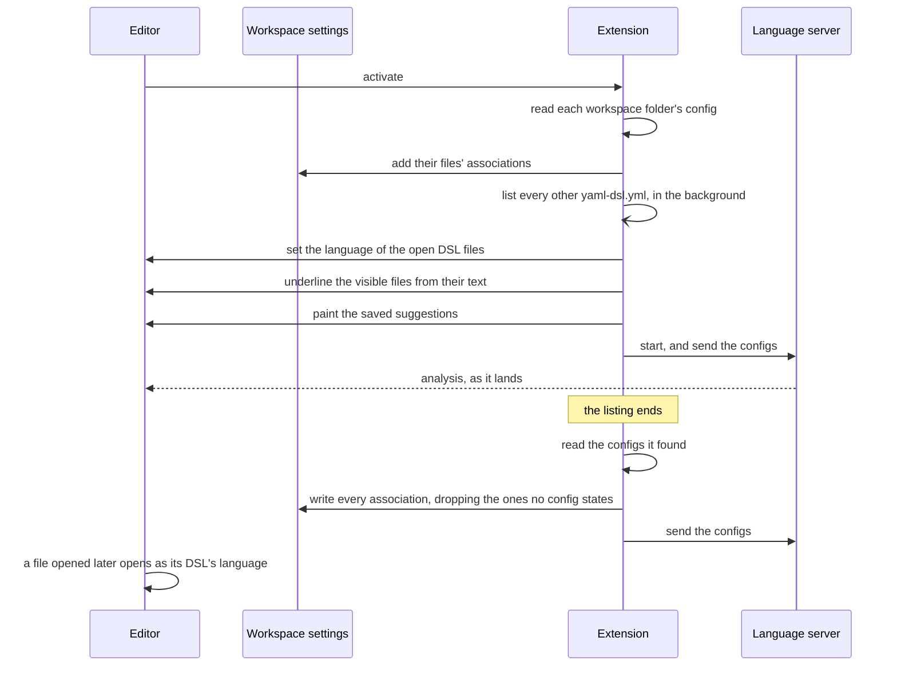
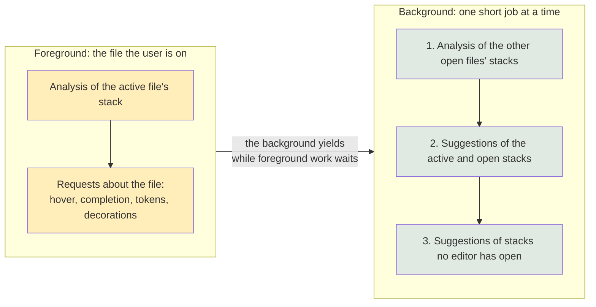
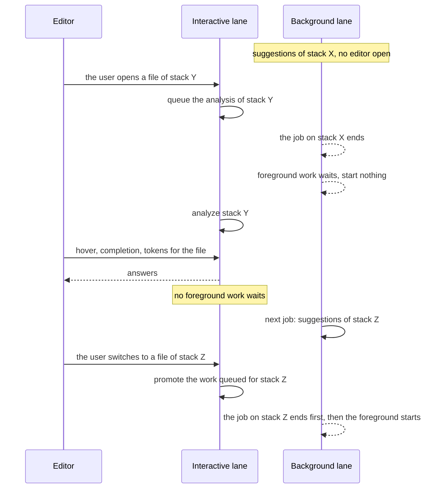
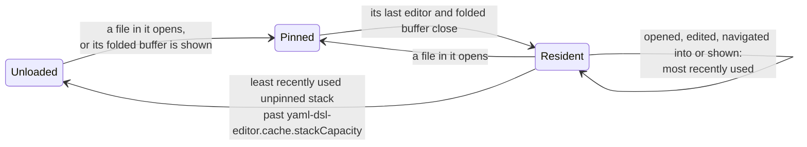
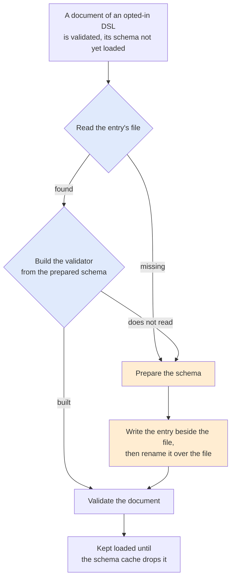
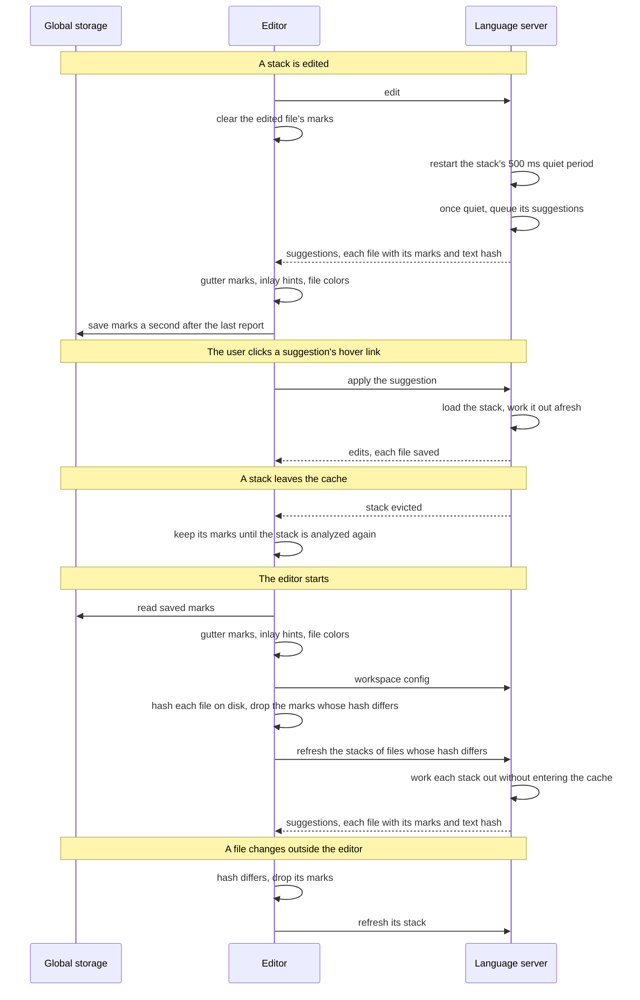

# YAML DSL editor

Authoring `mock-dsl.yml` is hard without this extension:

- A stack is a common layer and its overlays. The file on screen is one of those, not an overlay's full config.
- A field's documentation sits beside a `$ref` the usual YAML tooling never reads.
- A `ref` and a `local` are strings, so nothing jumps to the declaration.

The extension is the editor that makes that document authorable.

## Generic by config

Specified by the YAML DSL standard, [yaml-dsl-spec](https://github.com/litebitus/yaml-dsl-spec/blob/main/docs/spec.md), under Generic by config.

`mock-dsl.yml` is the DSL this document works through:

- Its field types are shared definitions, because a value may be a scalar, a `ref`, or a bare `local`.
- A simpler DSL uses the same engine through its own config block.
- It is the first config block, and its files are the first the editor is proven against.

Features are tuned iteratively. The first slice is what any editor for a programming language provides: hover documentation, and navigation of refs and locals. Diffing overlays, suggestions and extraction into the common layer follow, tuned the same way.

The editor validates, navigates, completes and hovers scopes, references, placeholders and calls the same way in every DSL.

## Language server

The editor is a language server. Activating any `mock-dsl.yml` puts the whole stack in scope, the common layer and every adjacent overlay, and the server holds that context:

- Switching from one file of the stack to another uses it; rebuilding the stack on each switch would be slow.
- It keeps the stack current as the files change, the folded document of each overlay included.
- The folded documents are buffers in the editor view, so the author sees an overlay's full config instead of assembling it from the files.
- Hover and navigation run against the stack in scope, not against the active file alone.

### Analysis

On each change the server parses the changed YAML, reads that file's schema, and resolves references, placeholders and calls across the stack. Hover and navigation are requests against that analysis; problems and suggestions are further results of the same pass.

A problem has a severity, drawn in the color the DevOps tools print it in:

| Severity | At its range | In the gutter | Color |
|---|---|---|---|
| error | red text and a red squiggle | the error mark | the failure red |
| warning | its own mark, such as a struck-through key | a triangle | the warning yellow |
| info | a wavy underline, the text unchanged | the info mark | the info blue |

- A problem shows its message on hover, then its schema note, if it has one.

The editor is faithful to the user's schema:

- It follows the schema as written, and never fixes it.
- Requiredness markers and the function table are the YAML DSL standard's own constructs, read by the standard's rules. Reading them is following the standard.
- A marker states the author's intent where the schema's own keywords do not, and keeps that intent readable in any viewer that shows only the description; the editor honors both the marker and the keywords, the marker deciding over the `required` array.
- Schema text is shown as the schema wrote it, never stripped, trimmed, reworded, rejoined or merged onto one line; a description keeps its marker.
- Style is the only thing the editor applies to schema text: its color, its place in the panel, and escaping for display, so each character shows as written.
- Where the editor would add what the schema already states, such as its requiredness marker beside a description carrying one, it drops its own copy, never the schema's.

Schema text is told apart from the editor's own text:

| Where | Schema text shows |
|---|---|
| a problem, an error or a warning | as its schema note, under the editor's message: `[schema]` in bold, then the note as written, all in the theme's `overlayHeadingForeground` |
| documentation sharing a panel with the editor's text: the field hover, function, macro and argument hovers, their completion documentation and the shape hint at a value | in the theme's `overlayHeadingForeground`, with no label, since documentation is the schema's |
| a panel holding the schema's text alone | uncolored, with no label |

- A description's HTML is shown as text.
- An empty range covers its whole line.
- The gutter marks share one size.
- An info problem is a schema the file names that cannot be loaded.
- A validation error takes the severity its setting names.
- The validation errors on one key share one hover: a `validation errors` heading in bold, in the theme's `validationErrorsHeadingForeground`, and each error a bullet, its schema note under it.
- Every warning but a deprecation is underlined in yellow.

Keys:

| Problem | Severity | Message |
|---|---|---|
| a key with no `:` yet | error, on that key only | `` `<key>` needs a `:` `` |
| a key its map holds more than once | warning, every copy's key underlined in yellow | `` `<key>` is also at line <n> `` |

- A key with no `:` is no error while the cursor is on its line; the error shows once the cursor leaves it.
- The lines around a key with no `:` are read as if the key were not there.

### Startup

The extension is an editor first, and nothing it does holds back the file. Its first act on startup is to claim the DSL files, before anything else reads them:

1. It reads each workspace folder's own config and writes its files' associations, so a file opened from then on opens as its DSL's language.
2. It lists every other `yaml-dsl.yml` in the background, and writes their associations once they are read.

Then, on startup and for every newly opened file:

1. The file opens as its DSL's language at once, colored by the grammar, its references underlined from the text.
2. The suggestions saved from earlier sessions paint next, from the one file that keeps them.
3. Analysis starts in the background, and its classes, problems and suggestions paint as they land.



The workspace holds many stacks. The server loads one when a file in it is first opened, and loads no other. A resident stack is the parsed common layer, every adjacent overlay, the symbol index, and the folded document of each overlay. Switching files inside a resident stack is a hit.

### Processing model

The work splits into the foreground, the file the user is on, and the background, everything else. The foreground always comes first.

| | Foreground | Background |
|---|---|---|
| Work | the active file's stack: its analysis, and every request about the file | the other open files' stacks, then the suggestions of the active and open stacks, then the suggestions of stacks no editor has open |
| Starts | at once | only while no foreground work waits |
| Runs in the language server | the interactive lane | the background lane, one job at a time, highest priority first |



Interruption and refocus:

- A background job is short: one stack's analysis, or one stack's suggestions.
- Between two jobs the background lane yields, and while any foreground work waits it starts none.
- Opening a file, or switching to one, makes its stack the foreground: work already queued for it is promoted, and its analysis starts at once.
- Only a job holding the same stack makes the foreground wait, and only until that job ends.
- A request about a file is answered once that file's analysis is done.



The staleness checks are what starts work, and nothing else does.

On the client, a report costs one pass:

- Applying a report to the kept suggestions rebuilds, once, the marks painted in the editors and the file and folder sets the Explorer reads.
- The Explorer asks about every file and folder it shows, so each answer is one lookup in those sets.
- The extension's settings are read once, and again only when they change.

### Stack cache

The cache is bounded, and the unit is the stack:

- A stack with a file in an open editor is pinned, and so is a stack whose folded buffer is on screen. A pin is never evicted.
- Opening, editing, navigating into or showing a stack marks it most recently used. Background work is not use: rebuilding stacks after a config change keeps their places.
- Capacity beyond the pins is the setting `yaml-dsl-editor.cache.stackCapacity`.
- Loading a stack past that, or lowering the setting, evicts the least recently used unpinned stack: its analysis is dropped and its folded buffers close. The files on disk stay, and the next activation loads the stack again.
- A change to a resident stack updates it in place.



### Schema cache

A stack's schema is the `schema.json` of the grammar version that stack initialized:

- The same grammar version is the same schema, so every stack on that version shares one parsed copy.
- A different grammar version is a different schema, however small the difference, and hover for a stack uses its own version's schema.
- The cache's unit is the distinct schema, one entry per hash. Bytes identical to a schema the server holds are that schema and are not parsed again.
- A schema a resident stack uses is pinned. Capacity beyond the pins is the setting `yaml-dsl-editor.cache.schemaCapacity`; past it, the least recently used schema is dropped.
- Evicting a stack unpins the schemas only it used.
- What the extension works out from a schema, such as the node fingerprints and validators of the schema checks, belongs to the schema's entry and goes with it.
- A modeline's fragment names a node of the schema it reads: the schema is cached once by its text, and the fragment is kept with the reading file, never as a cache entry of its own.

The validating worker loads each schema through the YAML DSL standard's schema cache, one per worker:

- Its capacity is `yaml-dsl-editor.cache.schemaCapacity`.
- A schema the worker is sent stays loaded until the editor's schema cache drops it.

A DSL's `performance` block states how the editor keeps a large schema fast:

| Field | What it states |
|---|---|
| `schema_store` | whether the schema cache's store keeps the standard's prepared schema in the extension's storage, read in later sessions instead of prepared again |

| Kept | Where |
|---|---|
| an entry | one file per entry key, named by the key, in the extension's storage |
| its content | the standard's prepared schema: the draft, the schema as written, and the schema its requiredness markers are read into |
| its key | the standard's, so a schema or package version that differs never reads it |

- A write goes to a new file renamed over the entry, so a reader finds the whole of one write or the other.
- An entry that does not read is prepared again from the schema and written over.



### Staleness checks

What the extension holds is a copy of what the files say: a resident stack's analysis, and a file's kept suggestions. Each copy is checked against its source on these triggers, every input takes effect without reloading the window, and every change to the extension keeps them:

| Trigger | Checked | Then | Lane |
|---|---|---|---|
| a file of a stack that is not resident is opened, or becomes active | on the open | the stack is loaded and analyzed | foreground |
| a layer file is edited in an editor | on the edit | the stack is analyzed again in place, its suggestions once the quiet period ends, and the file's painted marks are cleared until the next report | foreground, then background |
| a layer file of a resident stack changes on disk while no editor has it open | on the change | the file is read again | background |
| a layer file is deleted from disk | on the deletion | the file leaves the stack, even while an editor holds it with no unsaved edits, and comes back when it returns to disk | background |
| a folder at an overlay's place appears or goes, an overlay file is created or deleted, or a file changes below the overlay directories of a stack with no overlay file | on the change | the stack is built again, each overlay holding no documents found again | background |
| the file an include's location maps to is written to or removed from disk | on the change | the include is followed or left, and the stack of the overlay holding it is built again | background |
| a layer file's tab opens again on a document the IDE kept after its last tab closed | on the open | the editor's copy is analyzed again, as on an open | foreground |
| a layer file's editor closes: its document closes, or its last tab closes with no unsaved edits while the IDE keeps the document | on the close | the file is read from disk again, so discarded edits, or a file gone from disk, leave the stack with what the disk holds | background |
| a path a resident file's schema search reads changes on disk | on the change | that file's schema reloads, its stack is analyzed and validated again, and its hover documentation reads the new schema, the common layer's for that overlay; a schema on disk changes when its stack is initialized again | background |
| a schema URL's kept copy is older than the max age a file gives it | when a stack reading it loads | the copy is checked with the server, as under Schema URLs | foreground |
| an overlay's schema reloads | on the reload | the common layer's validation errors are worked out again, each naming exactly the overlays whose current schema its value fails | background |
| a `yaml-dsl.yml` is saved, created or deleted, or a workspace folder is added or removed | on the change | the configs reload; every resident stack is analyzed again under them, and a stack they no longer claim is dropped | background |
| a file's text on disk differs from the hash its kept suggestions were worked out from | at startup, and when the file changes on disk | its kept suggestions are dropped, and its stack is worked out again without entering the cache | background |
| the schema a file reads differs from the hash its kept suggestions were worked out against | at startup, and when the schema changes on disk | its kept suggestions and validation error mark are dropped, and its stack is worked out again without entering the cache | background |
| another build of the extension worked out a file's kept suggestions | at startup | they are never shown, and the stack of each such file still on disk is worked out again | background, last |

These hold through every change:

- A stack never opened, and with nothing kept, is never processed.
- Hover documentation is worked out on each request from the schema loaded now; a schema's parser, validator and renderer are kept with that schema and leave with it.
- A save, or a change that edits no text, keeps a file's suggestions and its painted marks.
- An evicted stack's kept suggestions stay shown until the stack is analyzed again.
- A click on a kept suggestion works its stack out afresh before writing anything.
- An extension setting change applies at once, and reworks no stack.
- Terraform's function metadata is read once per session.

### Output

The YAML DSL output channel exists from activation and logs:

- each startup step;
- the build of the extension it runs;
- the first analysis of each opened file, with its time;
- each schema URL read: downloaded, kept copy used with its age, or not downloaded; a check the server answers unchanged is not logged;
- every failure.

A startup step that fails is logged and skipped, so the language server always starts and the file always shows.

### Boundaries and tests

- The server does not run the engine. The continuous compile is the editor's analysis; plan and admission stay with the engine.
- The extension process is the client. The analysis is a plain module with no editor API in it, tested on its own with `node --test`. Editor features stay in the language server.
- Line coverage and branch coverage of the extension's own code are each at least 90%. The `node --test` run measures both and fails if either is under that; test files are not part of the measured set.

An integration test that proves something does not happen waits on the extension's own signals that its work has finished, never on a fixed time:

| Signal | Answers |
|---|---|
| the server's `yaml-dsl/idle` request | `null` once every request and notification the server received before it has been handled and no suggestion pass is in its quiet period or queued; an error once that work outlasts its bound. It only waits: every pass keeps its quiet period, its superseding by an edit and its order. |
| `whenSettled()`, which `activate()` returns beside the client | resolves once the work the client tracks has finished and the server has answered `yaml-dsl/idle`; rejects once that work outlasts its bound |

## Common layer and overlays

Specified by the YAML DSL standard, [yaml-dsl-spec](https://github.com/litebitus/yaml-dsl-spec/blob/main/docs/spec.md), under Common layer and overlays.

- An overlay holding no documents is an overlay of its stack wherever the editor reads the stack's folds: its fold is the common layer alone, read against the schema found from its place, and it is named as any other overlay is.
- A common layer with no overlay file in any overlay directory is a document with no overlays, read as if no overlay directory existed: a stack of its own.

### Folded documents

Specified by the YAML DSL standard, [yaml-dsl-spec](https://github.com/litebitus/yaml-dsl-spec/blob/main/docs/spec.md), under Folded documents.

An author editing one of those files sees only that file, so the language server buffers the stack in the editor view:

- While any file of the stack is active, refs and locals resolve in that file's fold.
- Across overlays the editor diffs the folded documents.

A block repeated in every overlay is one edit away from drifting: the next change lands in a single overlay and the others keep the old copy. The editor suggests moving that block into the common layer, and one click applies it.

### Overlay includes

Specified by the YAML DSL standard, [yaml-dsl-spec](https://github.com/litebitus/yaml-dsl-spec/blob/main/docs/spec.md), under Overlay includes.

- Move suggestions compare the overlays that merge a common layer at the same place, and move a unit below that place into it.
- An overlay is its full path, and is shown by its file name, or by its folder and file name where two of the stack's overlays share a file name, such as `dev/mock-queue.yaml` and `prod/mock-queue.yaml`. Overlays whose shown names still match keep them, so the author sees the duplicate. Where the doc takes overlays in `layers.overlay_folders` order, these are taken in the order of their path from the config's folder.
- A stack is built from its overlays: reading an overlay follows its includes, and a common layer's stack holds the overlays read so far that include it. Startup searches for no overlay.
- Command-click on a location opens the common layer.

## Formatting

The formatter is the editor's document formatter for every DSL file, and writes the canonical form the DSL's `formatter` block states.

| Trigger | Formats |
|---|---|
| Format Document, and format on save when the user's `editor.formatOnSave` is on | the whole file |
| Format Selection | the entries the selection touches, and the blank lines around them |
| a move or a delete | each block it writes, and the blank lines around it |

| `formatter` field | States |
|---|---|
| `indent_spaces` | spaces per nesting level |
| `list_items_indented` | whether a list's `- ` items sit one level under their key, or level with it |
| `flow_list_max_items` | a list of scalars with at most this many items is written in flow style, `[a, b]`; a longer one in block style |
| `flow_map_max_items` | the same for a map of scalars |
| `flow_max_line_length` | a list or map within its item count is written in block style when its line, indentation and key included, would be longer |
| `inline_comment_spaces` | spaces between a value and its `#` comment |
| `key_sort_orders` | the order of a map's keys, by path |
| `list_sort_orders` | the order of a list's items, by path |
| `blank_lines_between_entries` | blank lines between a map's entries or a list's items, by path |

Each path entry has `path`, `skip_keys` and its value, and the first entry whose path selects a map or list decides. A map or list no entry covers keeps its order and its blank lines.

| `key_sort_orders` `order` | A map's keys |
|---|---|
| `alphabetical` | sorted |
| `significance` | the keys `first_keys` lists, in its order; every other key in the schema's written order, then the keys the schema does not list, in their written order; then the keys `last_keys` lists, in its order |

| `list_sort_orders` `order` | A list's items |
|---|---|
| `alphabetical` | sorted by their text; a list of maps by each item's text, written in flow style |

- A key moves with its value, its nested lines, and the comment lines directly above it; blank lines go above the comment.
- The spelling and quoting of a scalar stay, so a format never rewrites a `ref`, a `local` or a `${...}` placeholder; long lines stay unfolded.
- A list of maps is always in block style, and an empty list or map is `[]` or `{}`.
- The formatted text parses to the same value as the text before it; when it does not, nothing is written and the reason is shown.

## Paths

Specified by the YAML DSL standard, [yaml-dsl-spec](https://github.com/litebitus/yaml-dsl-spec/blob/main/docs/spec.md), under Paths.

## YAML tags

Specified by the YAML DSL standard, [yaml-dsl-spec](https://github.com/litebitus/yaml-dsl-spec/blob/main/docs/spec.md), under YAML tags.

- Hover and completion read the expanded form.

## Scopes

Specified by the YAML DSL standard, [yaml-dsl-spec](https://github.com/litebitus/yaml-dsl-spec/blob/main/docs/spec.md), under Scopes.

## Locals

Specified by the YAML DSL standard, [yaml-dsl-spec](https://github.com/litebitus/yaml-dsl-spec/blob/main/docs/spec.md), under Locals.

- Each fold resolves each local once, and an edit resolves the edited file's folds again.
- Moving a block into the common layer writes each difference as a local.
- Go to definition opens the key at a local's path.

## Loop variables

Specified by the YAML DSL standard, [yaml-dsl-spec](https://github.com/litebitus/yaml-dsl-spec/blob/main/docs/spec.md), under Loop variables.

- Hover on a loop variable shows the loop that declares it and the items it is bound to.

## Navigating references

| Action | On a reference naming one declaration | On a reference naming several | On a builtin, or nothing visible |
|---|---|---|---|
| Go to definition | opens the declaration | does not move | does not move |
| Command-click | opens the declaration | opens a popup at the reference showing them all | does not move |
| Resting the pointer | no popup of the extension's | the editor's Command-click tooltip on its link | an error reads `Invalid reference: <scope>.<name>` |

- The popup shows the declarations in this language, each section headed by its overlay's name, `common layer` for the common layer's, with the file name in parentheses when it differs from the overlays' file name, as in `common layer (concern-1.mock-dsl.yml)`; the heading opens the declaration.
- A reference nothing visible declares is an error. A builtin has no declaration; its hover and its completion entry read `` `<name>`: *builtin* ``.
- The references peek is not opened.

In `mock-dsl.yml`:

- A ref is a whole scalar `ref <type>.<name>`, with an optional field path after the name. Its scope is `<type>`, the mapping key enclosing the declaration.
- A local is a key under `locals`, referenced as a whole scalar `local.<name>` or as `${local.<name>}` inside a scalar, with an optional path `.<key>…` after the name.
- A value shared by entries is a local in the common layer.

### Classes

The editor underlines each reference from the text as soon as the file opens, using the config's reference rules, and redraws it by its class once the analysis answers:

| Class | Resolves | Drawn |
|---|---|---|
| local | in the same file | a straight underline, the text's own colors |
| external | in another file of the stack | a squiggle, the text's own colors |
| error | nowhere visible | red text and squiggle, with an error mark in the gutter |

The whole reference takes its class's underline, placeholders inside it included.

### Coloring

- The editor colors references, placeholders and calls from the config: a reference rule's leading literal, its target groups and its other literal text; a placeholder's delimiters and builtin body; a call's marker, function and splat.
- The grammar colors plain YAML only, as the HCL editor colors HCL: keys are identifiers, strings are strings, and numbers and `true` / `false` / `null` are constants.
- The extension takes the whole of a file's coloring, so the editor's bracket pair colorization does not apply: a bracket keeps the color of the text it stands in.
- A `#` starts a comment only at the start of a line or after whitespace.
- A matching file takes the extension's file icon.

## Renaming

Rename Symbol, from its shortcut or the context menu, renames a name of a scope across the stack:

- every declaration of it, in the common layer and every overlay, since an overlay overrides a declaration by repeating its name;
- every reference that reads it, in every file of the stack, each taking the new name in the spelling of the declaration rule.

The rename box shows the name as declared. A rename is refused, with the reason, for:

- a builtin;
- a name declared for every name at once;
- a name made of a local's value;
- a name the scope already declares;
- a new name the edited files do not read back as that name.

A declaration whose name is edited by hand, while other declarations or references in the stack still use the name it had, gets a suggestion to rename it everywhere: the same edit as Rename Symbol, applied and saved like a move.

- The name it had is the one the rest of the stack last used, so a rename that leaves nothing using that name forgets it.
- Declarations renamed by hand from one name to the same new name are copies of one rename, not a clash.
- The click first takes the hand edit back in the active editor: an unsaved one by reverting the file, a saved one by writing the name it had back and saving.
- It then renames the name as Rename Symbol does across every file, that one included, and saves them, so one undo takes every file back to before the hand edit.

## Completion

Typing the start of a reference opens the list of what it can name.

- Each config reference rule is a literal with named groups, which the editor turns into a template: `^ref (?<type>…)\.(?<name>…)` writes `ref <type>.<name>`.
- A symbol fills the template, and the result is kept only when the rule's own pattern reads it back as that symbol.
- A character class of listed characters or ranges in the literal gives one template per member, so the placeholder pattern `[$&]\{(?<body>…)\}` opens with `${` and with `&{`.
- A rule whose pattern holds anything else, such as a negated class, a quantifier or an alternation outside a named group, offers nothing.

The list holds what the file's fold sees and what is visible from the cursor:

| Where | The list holds |
|---|---|
| an overlay | the common layer's symbols and its own |
| the common layer | its own symbols, and those declared in every overlay |
| inside a placeholder | every reference a placeholder body may be, builtins included |
| in a loop's body | each loop variable around it, written by every rule of the loop scope |
| a key typed `<name> <call_marker>` | every function and macro, each with its call marker and signature |
| a key typed `<call_marker>` with no name, beside other keys of its map | the macros, whose call stands as a whole key |
| a key typed `<call_marker>` with no name, the only key of its map, `calls_without_name_allowed` true | every function and macro |
| a key with no `<call_marker>` typed, or at a path `calls_not_allowed_at` lists | no function |
| a key in a map binding a call's arguments by name | the arguments not yet written, each with its signature and description, its row `[required]` for a required argument whose description carries no marker; a `map` or `list` argument writes its key and an indented line, one with a `default` writes `key: <default>` with the default selected, any other `key: ` |
| a value starting with `!`, a call's tag | each tag `tag_keys` declares, with the signature of the function its key calls |
| at a `function_call` macro's callee typed `function` or `macro` | the vocabulary's entries of that kind, without the call marker, each with its signature |

- A declaration keyed by a local is offered under the local's value, the spelling a ref uses for it.
- A ref completes up to the declared name; the field path after it is the author's.
- The list opens as the reference starts and narrows on every character, by the editor's fuzzy match against everything typed since the reference began.
- A reference starts when what is typed matches the start of its template in any case, and an entry is written in the case its rule spells.
- Each entry names the declaring file and shows the declaration as authored.

### Schema fields and values

The file's schema completes keys and values, read by the parser of the schema's draft:

| Where | The list holds |
|---|---|
| a key in a map | the fields the schema lists for the map |
| a key in a map whose `additionalProperties` admits keys | one entry per open key, written `<key>: <value>` |
| a list item | the fields of the item schema, or its values |
| a value after a key | the field's `enum` and `const` values, and `true` / `false` for a boolean, each `const` with its own description |

An open key's entry is built from the map's schema, and its full text is the description of the field holding the map:

| Key schema | Key written |
|---|---|
| `propertyNames` with `enum` or `const` | each name, one entry per name |
| `additionalProperties` | `<key>` |

| Value schema | Row | Inserted after the key |
|---|---|---|
| `enum`, `const` or `boolean` in every form | `<key>: a \| b` | a choice of the values |
| one type | `<key>: <type>` | `<type>` as a placeholder |
| several types | `<key>: <type> \| <type>` | an empty placeholder |
| a map | `<key>:` | a new line indented one level |
| a list | `<key>:` | a new line holding `- `, the item's placeholder after it when the item is a scalar |

- A placeholder key is selected on insert, and Tab moves to the value.
- Keys `patternProperties` admits are validated, never offered.

- A field's row shows its requirement and description, cut to the row's width: the description as written when it carries a marker, the editor's marker before it when it does not, `[required]` for a field the parent's `required` array lists. The description as written shows beside the list, under the editor's marker only when the description carries none.
- Completion documentation renders HTML, so schema text shows as the table under Analysis states.
- A deprecated field is struck through in a draft that reads `deprecated`.
- A key in a common layer local that a merge reads completes the fields every overlay's schema states the same at every map the local lands in.
- Word completion is off in DSL files, so the list holds only what the schema and the references offer; a user's own `editor.wordBasedSuggestions` for the language still wins.
- A field's value forms are its schema with references, `allOf`, and each `anyOf` or `oneOf` alternative resolved.
- A field whose every value form is a map or a list inserts its key and a new line indented one level; any other field inserts `key: `, and opens the list of its values when it has any.
- A scalar field whose schema states a `default` inserts `key: <default>` with the default selected, and opens no list.
- The cursor's place is read from the document with the cursor's line taken as a key, so a line still being typed is placed by its indentation; text inside a block scalar offers nothing.
- The list opens as a key or value starts and narrows on every character, by the editor's fuzzy match.

### Required fields

Enter after a key whose map is still empty fills the map's required fields:

- A field is required when its requiredness marker is `[required]`, or when it has no marker and the parent's `required` array lists it; a `[~required]` field is not filled.
- A field the common layer already gives the map in the stack's fold is not filled.
- A field the key sets, by the `validator`'s `child_values_from_parent_key`, is not filled.
- The fields are ordered by `formatter.key_sort_orders` for the map, and in the schema's written order where it does not decide.
- A scalar field is written `key: `, its values a pick list when it has any, or `key: <default>` with the default as the stop's text when its schema states a `default`; a map or list field is written `key:` and an indented line.
- The cursor waits at the first value; the fill is one undo step, and leaves the new line.

Enter after a key with no value whose schema expects a map with nothing to fill starts the next line one level under the key; one whose schema expects a list writes `- ` there. Both open the shape hint.

Enter after a list item holding a key and a value, `- <key>: <value>`, starts the next line under the key, for the item's next field; after any other line it keeps the line's indentation.

### Shape hint

The shape hint is the editor's parameter hints widget, showing what the schema expects at the cursor's line:

| Where | The hint shows |
|---|---|
| a key in a map | a row per field not yet written and per open key, each `key: <value>` as completion writes it, under the description of the field holding the map |
| a new list item | the item's fields, or its values as `- a \| b` |
| a value after a key | `key: <value>`, under the field's description and a bullet per value, `` `value`: `` then its own description |

- Its documentation renders HTML, so schema text shows as the table under Analysis states.
- It opens after Enter writes a value line, and by the editor's parameter hints command anywhere.
- It stays open while the cursor is on that line, and closes once the cursor leaves it.

### Keys in the list

In a DSL file:

| Key | While the list is open | While filling required fields |
|---|---|---|
| Tab | highlights the next entry, wrapping; accepts the entry when it is the only one | moves to the next field's value, and past the last to the end of the block |
| Shift+Tab | highlights the previous entry, wrapping | moves to the previous field's value |
| Enter | accepts the highlighted entry | |

The list takes the keys while it is open, required fields being filled or not.

## Hover documentation

The Red Hat YAML extension is not used: it resolves a field to the schema node a draft-07 validator sees, and for these DSLs that node is a shared value definition.

A field's value `$ref`s a composite such as `string_or_ref` or `string_list_or_ref`, because the value may be a scalar, a `ref`, or a bare `local`, and the field's own documentation is written beside that `$ref`. Draft-07 ignores every keyword beside a `$ref`, so a compliant hover shows the composite's text, "a literal string, a `ref`, or a bare `local`", and never the field's:

```json
"label": {
  "$ref": "#/definitions/string_or_ref",
  "description": "[required] Mock label for the thing (or `ref`)."
}
```

A schema for this kind of value is built this way. This extension reads the schema document as authored:

- Hover walks the YAML path through `properties`, then `patternProperties`, then what the schema's draft reads for a key `properties` does not list.
- On an object that carries both a `$ref` and a `description`, it keeps that `description`, then follows the `$ref` only to keep walking.
- A field an `allOf` part or an `if` branch restates keeps what the object states for it that the restatement does not, such as its `description` and its `items`; where both state a keyword, the restatement's applies, except a schema for its items or unlisted keys, which is restated the same way.
- The tooltip documents the field, as a javadoc documents a method:

| Part | Shows |
|---|---|
| signature | the field's name and, when its description carries no marker, its requirement as code, and its effective forms in italics after following `$ref`, `allOf`, each `anyOf`/`oneOf` alternative and the field's own `if` branch the value selects, each named by the definition the field refers to or by its type; a definition whose own `if` branch the value selects is named by that branch's definition, and a form adding its own type or properties to a definition is named by its type |
| description | the description kept at the field, as written, rendered as markdown, shown as the table under Analysis states; the composite's description is the value shape and is not shown |
| accepts | one line per form, with its constraints, when the field has more than one form; under it, the description its `anyOf`/`oneOf` alternative states, as written |
| tags | one line per constraint, when it has one form: values, default, pattern, bounds, lengths, items, dependencies, deprecated |
| conditions | each `if`/`then`/`else` on the object, as when and otherwise; and on a field, what its parent's dependencies require when it is set, and its parent's conditions that name it, cut to what they say about the field |

- With the document's value at hand, the conditions are the branches the value selects, as when or unless, each followed into the conditions it holds. A branch whose condition or consequence it cannot read in words is left out, and so is a branch that only refers to a definition, which the signature already names.
- A consequence that gives a field a referenced schema reads as that field being the definition, such as `` `Properties` is a `AWS::S3::Bucket` ``.
- The draft's renderer reads its own keywords, as its parser and validator do; without a value, a part it cannot read in words names a condition the schema states.
- A key that sets a field of its entry, by the `validator`'s `child_values_from_parent_key`, documents its entry, then the field it sets, as that field's own tooltip would, under `*Sets* <field> *to* <value>:`. An entry that writes the field itself documents its entry alone.
- A key the DSL's `marker_function` reads as a call naming a field documents that field, as a key writing the field would; its function is documented by the function's hover.
- In the common layer the tooltip documents the field in each overlay's schema; overlays whose documentation is the same share one section, headed by their names, and overlays whose schema has no such field are named last, as not a field.
- A key in a common layer local that a merge reads is documented by each overlay's schema at each map the local lands in. A section's heading names `overlay:path` terms: overlays merging at the same paths are grouped and the paths' common prefix is factored, as `{dev,prod}:queue.{orders,payments}`, and a long heading wraps only between terms.
- A section's heading is its overlays' names in bold, in the theme's `overlayHeadingForeground`.
- A description's HTML is shown as text, so a tag written in prose reads as written.

### Requiredness markers

Specified by the YAML DSL standard's [package design](https://github.com/litebitus/yaml-dsl-spec/blob/main/docs/package-design.md), under Requiredness markers.

- Every schema check the extension runs reads requiredness this way: validation, completion, required-field filling and hover.
- A description keeps its marker, and the editor shows no marker of its own beside it, as the faithfulness rules under Analysis state.
- A fragment requires no key, so its hover shows the marker the editor adds struck.

### Finding the schema

Specified by the YAML DSL standard, [yaml-dsl-spec](https://github.com/litebitus/yaml-dsl-spec/blob/main/docs/spec.md), under Finding the schema.

- Hover, completion and required-field filling read a fragment from its root node.
- The modeline's path is a link that opens the schema it names.
- The extension embeds no schema.
- When neither source resolves, field hovers stay empty. Navigation, other problems and suggestions still run.

### Schema URLs

Specified by the YAML DSL standard, [yaml-dsl-spec](https://github.com/litebitus/yaml-dsl-spec/blob/main/docs/spec.md), under Schema URLs.

- A downloaded copy is kept in the extension's storage, across sessions and workspaces.
- What a credentialed read reports, a refused credential, a missing release or asset, an unseen repository, is logged.

### Branches the document selects

- Where a node's schema holds `if`/`then`/`else`, hover, completion and required-field filling evaluate `if` against the instance at that node, as validation does, and read `then` or `else` by the result.
- Where the document has no instance at that node, such as completion in a common layer, which no single fold holds, they read both `then` and `else`.
- A schema whose shape hangs on a value, such as a resource's properties on its `Type`, is documented and completed by that value.
- Where a node's schema holds `anyOf` or `oneOf`, its children come from the alternatives whose `type`, stated on them or on the definition they refer to, admits the instance's JSON type: a list's items from an array alternative, a map's fields from an object one. An alternative adds fields, never requiredness, and without an instance, or with no alternative admitting it, no alternative adds any.

### What the schema is for

- DSL-level behavior is configured in `yaml-dsl.yml`: which files, the scopes, the syntax of declarations, references, placeholders and calls, how layers are grouped. The concepts are the editor's, the syntax is the DSL's, and that syntax does not move into the schema.
- The schema is how the editor understands a field and the shape of an object: which keys exist, what value shape a key takes, and the field's own description, the text beside a `$ref` included. It is read as published.
- The schema is what a document is validated against; a document that breaks it holds a validation error.
- When the schema is not enough to understand a field or a shape, the schema gains an extension point and the grammar publishes it; the extension does not grow a special case for that object. No such point is added before a field or a shape requires one.
- The extension defines the standard a schema follows to work with it: JSON Schema, and the editor's own keywords where JSON Schema says too little. Each keyword is named `x-yaml-dsl-<name>`, sits on the schema node it describes, and ships with its own JSON Schema, as `x-yaml-dsl-functions` does.
- The schema is not the engine's checks, which are a separate pass. A check can require a group of fields only when another field has a certain value, allow a field for only one mode, or allow exactly one of two fields; the published schema has no such table, and an extension point is not a transcription of these checks.
- A field may be filled from the common layer while the editor looks at one file, so a `required` array on the entry alone does not say whether the folded document is complete.

## JSON Schema drafts

Specified by the YAML DSL standard, [yaml-dsl-spec](https://github.com/litebitus/yaml-dsl-spec/blob/main/docs/spec.md), under JSON Schema drafts.

A schema whose draft is not read leaves field hovers empty.

### Parsers

Each draft has a parser, a validator and a renderer named after it, over one shared core each. The parser's core:

- picks the parser from `$schema`;
- resolves references;
- merges the schemas an applicator combines;
- finds the node at a document path, and a node's fields.

A parser states what its draft's keywords mean:

| | draft-07 | draft 2019-09 | draft 2020-12 |
|---|---|---|---|
| list items | `items`, `additionalItems` after a tuple | `items`, `additionalItems` after a tuple | `prefixItems`, then `items` |
| references | `$ref`, `$id` plain-name fragment | `$ref`, `$anchor`, `$recursiveRef` | `$ref`, `$anchor`, `$dynamicAnchor`, `$dynamicRef` |
| a key `properties` does not list | `additionalProperties` | `additionalProperties`, then `unevaluatedProperties` | `additionalProperties`, then `unevaluatedProperties` |
| merged as `allOf` merges | `allOf` | `allOf`, `dependentSchemas` | `allOf`, `dependentSchemas` |
| what a key needs when set | `dependencies` | `dependentRequired`, `dependentSchemas` | `dependentRequired`, `dependentSchemas` |
| `deprecated` | not read | read | read |
| validator | Ajv's draft-07 | Ajv's draft 2019-09 | Ajv's draft 2020-12 |

The validator's core compiles parts of a schema with its draft's validator, for the schema checks and the branches conditions select; a document is validated by the standard, under Validation.

A `pattern` or `patternProperties` key is a regular expression built with the `u` flag, as JSON Schema says.

A part of a schema is compiled on its own, with only the schema's nodes its `$ref` and `$dynamicRef` starting with `#` reach, followed through the nodes they reach; its cost follows what it reaches, never the whole schema:

- a branch's `if`, so choosing a branch compiles only what the condition reaches;
- a node's own keywords, which the schema checks validate an opt-out against.

### Validation

Validation is the YAML DSL standard's, specified by its [package design](https://github.com/litebitus/yaml-dsl-spec/blob/main/docs/package-design.md) under Schema validation: the standard's package reads a document by its DSL's `validator` block, validates it against its schema, and words each problem.

The editor hands the standard the document its loops and merge macros expand to, each value as the standard's resolved value:

| Written | Handed as |
|---|---|
| a scalar, a list or a map | itself |
| a whole reference, or a tag key holding one | a `reference` |
| a map whose one key is a call without a name | a `call` |
| a string holding a placeholder | a `template` |
| a key the DSL's `marker_function` reads as a call naming a field, such as `value fn.jsonencode` | the key as written, and the field it names as a `call` where the map writes none |

A problem's subject is placed back on the key that wrote it, through the call key, the merge macro and the loop that made it.

Each document is validated against its schema:

| File | Validated |
|---|---|
| an overlay | its fold, the common layer merged with it, against the overlay's schema |
| the common layer | through each overlay's fold, an overlay holding no documents included |
| a document with no overlays | alone, against its own schema |
| a file outside layers | alone, against its own schema |

- An error is marked on the key of the value it is about, in the file that wrote that value. In the common layer, its message names the overlays whose folds it fails in.
- A missing required field is marked on its map's key, and an unknown field on its own key.
- A dependency a key does not meet is marked on that key, its message naming what the key needs.
- A fold holding a file with a YAML error is not validated.
- A schema that cannot be compiled is one error at the document: `the schema cannot be compiled: <why>`, the reason as the standard states it.
- Validation reads the fold, so an opted-out key is not validated.
- A schema whose draft the editor does not read is not validated.
- Hover reads `child_values_from_parent_key` to document the field a key sets.
- Where `allow_quoted_values` reads a quoted value, hover and completion show the schema's types, and what the extension writes stays unquoted.

The `validator.*` settings show validation errors at a chosen severity, turn them off, and color the files holding them in the Explorer.

### Validating in a worker

The server validates documents in a worker thread, so a schema that takes long to compile never holds hover, completion or suggestions:

- The worker holds each schema it is sent, by hash, and drops the ones the schema cache drops.
- An answer is kept by the document's schema, fragment and value, one per file the stacks hold.
- A file whose answer has not arrived shows its previous answer, none at first. When the answer arrives, the file's problems are published again.
- A file has one request in flight; a newer document replaces it.
- A request past its deadline is a problem on the modeline line until its answer arrives.
- A worker that stops is started again and its requests sent again. A request it stops twice is a problem on the modeline line naming why.

### Deprecated fields

In a draft that reads `deprecated`, a deprecated key or value is a warning:

| Deprecated | When `deprecated: true` stands on | Struck through, and the warning's hover | Warning | Schema note |
|---|---|---|---|---|
| key | its field's node, a node its references reach, or an `allOf` part | the key; the hover of the key and its value | `` `<key>` is deprecated `` | the field's description, or the deprecated schema's where the field states none |
| value | a `oneOf` or `anyOf` branch the value passes | the value | `` the value of `<key>` is deprecated `` | the branch's description |

- the struck key or value is in the warning yellow;
- a field's documentation strikes the name of each deprecated `oneOf` or `anyOf` choice;
- its file, and every folder above it, are named in the warning yellow, with a `⚠` badge on the file and its tab.

A stack's report of its suggestions flags each file holding a warning, for a stack worked out in the background as for one an editor has open, and the flag is kept with the file's suggestions. A warning's color and badge show over a suggestion's.

| Setting | `false` turns off |
|---|---|
| `yaml-dsl-editor.warning.deprecation.enabled` | all of the above |
| `yaml-dsl-editor.warning.deprecation.fileDecoration` | the file and folder color and badge |

## Diffing across overlays

How a block is configured differently across overlays is read in one view, never by opening each overlay file and comparing by eye.

### Opening the view

- A diff button sits in the title bar of every layer file on disk, and the Command Palette offers it.
- While lines are selected, `Diff across overlays` tops the editor's context menu, whether or not a suggestion exists.
- With nothing selected, the diff takes the key on the cursor's line.
- One click opens the view with every overlay, beside the file, leaving the focus there.
- A button on the view, or the Command Palette while the view is active, chooses which overlays it diffs, the current ones checked, and renders it again with them.
- While the view is open it follows the selection: selecting lines in any layer file of its stack renders it again with the same overlays.

The view is a read-only document titled with the stack's path from the workspace root, overlay directory and file name left out. It shows the differences; resolving them is the author's.

### What the view shows

- The first line names the overlays it diffs and how many differences it found, `no differences` when they all agree.
- It diffs the keys the selected lines hold, their nested lines included, and writes the path from the document root down to them as plain lines for context.
- It renders them the way a move writes a block into the common layer: copied from the first overlay that holds them, in that overlay's key order, a list or map value in flow style.
- Each overlay's side is its folded document, the common layer merged with the overlay file by the engine's deep merge.
- Comments are never a difference.

| Case | Written |
|---|---|
| a line every checked overlay folds alike | once |
| a key whose value differs | once per distinct value, the lines grouped together, each labeled with the overlays that hold it in `layers.overlay_folders` order |
| a key an overlay lacks | struck, `key:`, among that key's lines and labeled with the overlay; its parents stay plain lines, so a missing key is struck at its leaf wherever it sits |
| a block an overlay lacks entirely | struck once at its key, above the block; the lines below diff the overlays that hold it |

Each difference, every line of one key, takes one background color, the next difference the next of the theme's `overlayDiff.difference<n>` mellow shades, so adjacent differences never share one.

```
mocktype:
  shared:
    label: mock-shared
~   size: 1  # overlay-1, overlay-3
~   size: 2  # overlay-2
    retention:
~     days: 7  # overlay-1, overlay-3
~     d̶a̶y̶s̶:̶  # overlay-2
    tags: [a]
```

## Suggestions

The extension suggests an edit where it can see one. A suggestion shows as:

- a suggestion mark in the gutter of the line it concerns;
- an inlay hint at the end of that line, whose hover says what the edit does and links to it;
- the holding file's name in the theme's `suggestionForeground`, with the suggestion mark as its badge in the Explorer and on its tab, every folder above it up to the workspace root taking the color.

The suggestion mark is the theme's, and the inlay hint's label opens with it:

| Theme | Mark |
|---|---|
| `dark` | a light bulb, `💡` in the badge and the label |
| `light` | `✦`, a plain character that takes the theme's color |

Each folder above a decorated file is decorated in its own right, so its color shows over the one a child's decoration carries up, such as source control's.

The edit:

- runs only on a click of the hover's link, once per click, and dismisses the hover;
- leaves no standing order behind it, and the hint itself takes no click;
- passes the schema of every file it writes.

Inlay hints:

- are on for the extension's own files, whatever the editor's default;
- read whole: the extension sets `editor.inlayHints.maximumLength`, and a user's own setting for the language still wins;
- come back after an empty answer: an editor stops asking a file that answered none, so the extension registers its provider again when suggestions reach that file.

Each kind of suggestion has its own settings under `yaml-dsl-editor.suggestion.<kind>`:

| Kind | The suggestion | Colors its file |
|---|---|---|
| `delete` | deleting a duplicate | yes |
| `move` | a move | yes |
| `potentialMove` | a potential move | no |
| `rename` | renaming a name edited by hand everywhere | yes |

| Setting | `false` turns off |
|---|---|
| `enabled` | the kind's suggestions |
| `fileDecoration` | the kind's file and folder color and badge, for a kind that colors its file |

Extraction into the common layer is one such suggestion.

### When suggestions are worked out

- Loading a stack starts its quiet period, and each edit to it restarts the period.
- Once the stack has had no edit for 500 ms, its suggestions are worked out behind the analysis of every open file, and sent apart from problems and underlines.
- Typing never waits for them.

### Kept suggestions

A file's suggestions outlive its stack leaving the cache and a restart of the editor:

| | |
|---|---|
| where | the extension's global storage, in a folder per workspace named by the hash of the workspace file or its lone folder, so uninstalling the extension deletes them with it |
| key | the file, with a hash of the text they were worked out from, and a hash of the schema it reads |
| build | the build of the extension that worked them out, a hash of its manifest and code |
| shown | until the stack is analyzed again; on startup as soon as they are read, their hashes checked after, in the background, as the staleness checks say |

- The kept file carries a format version. A breaking change to the format bumps it, and the extension migrates an older file to the current format when it loads.
- A file no migration reads is deleted, and its suggestions come back as their stacks are analyzed; the user never sees it.
- A field added to a suggestion reads as empty where an older file lacks it.



## Extracting the common layer

A unit that every overlay states for itself will drift: the next edit changes one overlay, and the others keep the old copy. Extraction puts that unit in the common layer so the stack has one copy.

### Units

A move takes one unit whole. `layers.duplicate_check` places the unit:

| Field | Meaning |
|---|---|
| `depth` | the unit sits this many levels below the document root; a key counts as one level, so `a.b.c` is three levels deep |
| `key_depths` | the unit's depth under a top-level key it lists |
| `skip_keys` | keys no suggestion compares or moves, at any depth |

- A scalar or list above that depth is a unit of its own.
- Nothing inside a unit moves on its own, and nothing above it moves as one block, so a unit never ends up split between the common layer and an overlay.
- With `depth: 2`, an entry keyed under its type, `<type>.<name>`, is one unit.

Values are compared as written:

- A reference, a local and a placeholder are their text, whatever they resolve to.
- Maps are compared key by key, and lists whose items match in number item by item; a list whose items differ in number is one difference.
- A map unit with a difference is offered only in a DSL with locals, outside the locals, and only when at least one leaf is the same in every overlay that holds it, since the difference is written as a local and the unit lands whole in the common layer.

### Moves and potential moves

Every place where the overlays disagree on a unit is a difference:

- a value that differs;
- a list or map some overlay lacks;
- a scalar some overlay lacks;
- the unit itself missing from an overlay.

What the click writes into an overlay draws the line:

| Differences | Offered as | The click |
|---|---|---|
| none: every overlay holds the unit, all alike | a move | deletes the copies and writes one into the common layer; no overlay gains anything |
| one | a potential move, with a link | also writes into an overlay to keep its fold, so the user decides |
| more than one | not offered | |

- A unit is offered when more than half the overlays holding a document, and at least two, hold it.

An overlay's fold is kept by what is written for it:

| The overlay lacks | Written for it |
|---|---|
| a list | `[]` |
| a map | `{}` |
| a scalar | the `default` its schema node states; with no stated default, the unit is not offered |

An overlay holding no documents lacks every unit:

- A unit every other overlay holds alike is a potential move, with a link.
- The click creates the overlay's document at its place, named as the stack's other overlays' files are, holding what is written for it. The overlay then holds a document.

A potential move is information: its gutter mark is the info mark, its hint starts with `ⓘ`, and it colors neither its file's name nor any folder above it.

### Schema checks

A block the walk finds passes two schema checks before it is offered:

1. Every overlay, holding the block or not, reads the node at the block's path in its own schema, an overlay holding no documents in the schema found from its place, and those nodes must be the same. Nodes of one schema are the same when they are one node. Nodes of different schemas are compared by a hash of each with its references resolved, its annotations (`description`, `title`, `examples`, `$comment`) set aside and its requiredness marker kept, worked out when first compared and cached per schema node.
2. Each opt-out passes the node at its own path in the schema of the overlay that takes it: `{}`, `[]` or the default, with requiredness read from the requiredness markers. A node's `if` is read against the opt-out, and only the branch it selects is checked.

A block that fails either check is a potential move with no link:

- Its hint names the check that failed.
- Its hover lists the overlays and the schema's own messages, so the user decides the fix.
- A failed `anyOf` or `oneOf` is listed as its alternatives, each with its own failures, an alternative failing in turn a nested list under `one of:`, and a failed `not` matches a form that is not allowed, the description of the schema it sits in its schema note, a `[schema]` line under it, so the user reads the schema's intent without opening it.
- Each failure and each schema note stands on its own line; a schema that cannot be compiled is worded as its validation error is.
- Once the schemas agree, or the overlays hold the block, the suggestions worked out next offer the move.

A field directly under the node marked `[~required]` is one the `{}` opt-out leaves out, and the extension does not read the condition. A block whose opt-out leaves one out is a potential move that keeps its link:

- Its hover names the overlays and those fields, and says the extension cannot tell whether the move is safe.
- The user may judge it safe, and the click applies the move as any other.

### The common layer file

- A stack whose common layer file does not exist yet is the starting point extraction is for: its moves read the common layer as empty, and the click creates the file.
- A new common layer starts with the keys `layers.duplicate_check.skip_keys` names that every overlay holds the same, since those are the keys each layer states for itself.
- A move writes into the first of the names `layers.common_layer_files` tries for the stack.
- When that file does not exist and a later name's does, the click creates it as a new common layer, holding the blocks of the common layer the overlays fold with now that their references reach, and the blocks the references inside those reach, each opened under its parent maps. Suggestions are worked out against that file.

### Moving a map unit

One click on a map unit:

1. Writes the unit into the common layer, copied from the first overlay in `layers.overlay_folders` order that holds every difference, comments, key order and the blank lines around it included, the difference replaced by a reference to its local.
2. Declares the difference's local, below.
3. Deletes the unit from each overlay that holds it, and a parent map left empty by that, merging the blank lines around it into one, and taking the blank lines after it when it sits right under its parent's key.
4. Writes `{}` at the unit's path into each overlay that does not hold it.
5. Saves every file it changed.

The difference's local:

| Case | The common layer declares | Each other overlay declares |
|---|---|---|
| one value is held by the most overlays | that value | its own value, or `[]`, `{}` or the schema default where it lacks the key |
| no one value is held by the most overlays | the empty value of their type: `""`, `0`, `false`, `[]` or `{}`, so the name resolves in an overlay that opts out | its own value |
| tied values of differing types, or `null` | no move is offered | |

A list or map in block style is declared on the lines below the local's name.

- After the click every overlay's folded document reads the same at the unit's path, with the new locals resolved, except where an overlay opts out: it holds its `{}`, `[]` or schema default there.
- Before writing anything, the click applies its edits to a copy of each file, folds the copies and compares them at the block's path. A mismatch writes nothing and says so.
- The hover names the block and how many overlays hold it, each difference with its values and the overlays holding each, and the overlays that opt out.

### Moving a value

A scalar, a list or a map in flow style is a unit by value:

- An overlay's value at its path is what its fold holds there: its own value, else the common layer's.
- When more than half the overlays holding a document, and at least two, hold one value the common layer does not, the editor suggests moving it into the common layer. The common layer's own value casts no vote.
- Every overlay holding another value, keeping the common layer's former value, or lacking it, is the unit's one difference.

One click:

1. Writes the value into the common layer at the path, over what the common layer held there, opening the maps above it the common layer lacks.
2. Deletes it from each overlay holding it, and a parent map left empty by that.
3. Writes the common layer's former value into each overlay whose fold held it.
4. Leaves each overlay holding another value with its own.
5. Writes `[]`, `{}` or the schema default into each overlay whose fold held nothing.
6. Saves every file it changed.

- A map where the common layer also holds a map, or where an overlay keeping its own value holds a map, merges, and is not moved by value.
- An empty map or list is an opt-out, not content, and is not moved.
- The hover also names the overlays that keep the common layer's former value and those that keep their own.

### Combined moves

Moves of neighboring keys in one map are one move. Two moves combine when:

- the same overlays hold each;
- the same overlays opt out;
- each key follows the other in every overlay holding them;
- the combined move holds at most one difference.

- Its hint names the keys, and its hover lists the blocks in order.
- The click writes them into the common layer one after another in that order, each placed and spaced by the overlays as they stood before the click, and each checked against the folds as a move of its own.
- While the cursor is on a suggestion mark's line, a border marks every line the suggestion takes.

### Deleting a duplicate

What an overlay holds the same as the common layer at the same path, no deeper than the unit, is a duplicate, and the editor suggests deleting it from that overlay at its topmost path.

- A key whose value is empty in the overlay or the common layer is not a duplicate, because an overlay's `null` deletes the key.
- One click deletes the duplicate, and a parent map left empty by that, and saves the file.
- That overlay's folded document reads the same after it.

### Applying a click

A key's comment is the comment lines directly above it, at its indentation. A click carries a key's comment with the key:

- Deleting a key deletes its comment.
- A key written from another file, or a map a move opens in the common layer, takes the comment it has there.

A new key goes where `formatter.key_sort_orders` says for the map it lands in, and the click then formats each block it writes. Each entry names a path and an `order`, and the first entry whose path selects the map applies, so specific paths come first.

| `order` | Places a new key |
|---|---|
| `alphabetical` | at its sorted place within the keys at the top of the map that are already in order, and where that order breaks when it sorts after them all; the keys after the break are not considered |
| `significance` | by three groups: the keys `first_keys` lists, in its order; every other key; then the keys `last_keys` lists, in its order |

Under `significance`:

- A listed key goes before the first key of the map that ranks after it.
- Any other key goes where the overlays holding it place it among the other keys: before the next of its neighbors there that the map holds, else after the previous one, taking the overlays in `layers.overlay_folders` order, and at the end of the other keys when none of its neighbors is there.
- Both lists are `[]` under `alphabetical`, and a key sits in at most one of them.

- Keys already in the map keep their order.
- A map no entry covers takes no new key, and a suggestion that would write one is not made.

Blank lines around a new key:

- It takes the blank lines above and below it in the first overlay holding it, in `layers.overlay_folders` order.
- A key no overlay holds takes one blank line above and below when it spans more than one line, and none when it is one line.
- The count includes the blank lines already beside where the key lands once every edit of the click is made, and none are added at the top or the end of the file.

Undo:

- A click is one undo step across every file it changes: the common layer and its overlays are one unit, so undoing the click in any of them undoes it in all.
- A click saves every file it leaves unsaved, and leaves a saved file alone.
- An undo or redo that brings one of them back to its text before or after a click saves it, so undoing a move leaves no file to save by hand.
- Undoing a click that created a file removes the file, and nothing saves it.

### Naming locals

A local is named by the block's key and the nearest named key above the leaf, joined with `_`:

- A named key is any key between them, except a key a `declarations` rule reads a name from, a list item, and a call.
- A call key contributes the name written before its call marker, and a call without a name contributes nothing.
- A name the stack already declares takes the next named key up in front of the nearest one, and once those run out, the block's ancestors' keys.
- The reference is the local reference rule's own form: a whole scalar where the rule allows one, else a placeholder.
- A difference whose name the reference rule cannot read back, and a map the edits must write into that is in flow style, are not suggested.

### Node ids

The parse gives every node an id from a table its stack shares:

| Node | Id from |
|---|---|
| a scalar | its type and value |
| a list | its items' ids, in order |
| a map | its keys and their values' ids, keys sorted |

- A second id counts every scalar alike, so two blocks with the same keys at every depth share it.
- Equal ids are equal values, so comparing two blocks is comparing two numbers; comments, quoting, flow or block style and key order do not count.
- Each id sits beside its node's source range, so a match leads back to the exact lines.
- The parse that answers every edit computes the ids, and an unchanged block keeps its id.
- One walk over the overlays' trees, path by path, finds the suggestions: where the overlays' ids agree the walk stops, and where they differ it descends only as far as the differences.
- The table belongs to the stack and goes with it when the stack is evicted.

## Placeholders

Specified by the YAML DSL standard, [yaml-dsl-spec](https://github.com/litebitus/yaml-dsl-spec/blob/main/docs/spec.md), under Placeholders.

- A valid body is classified like any other reference.
- Hover and navigation at a position inside a nested placeholder are the nested one's.

## Functions

Specified by the YAML DSL standard, [yaml-dsl-spec](https://github.com/litebitus/yaml-dsl-spec/blob/main/docs/spec.md), under Functions.

- Hover on a function shows its signature, colored by the extension's own signature language, `yaml-dsl-signature`, with the argument and return types, then its description, `*Arguments:*` and a bullet per described argument, `` `name`: `` then its description, and `*Returns:*` then the return's description, or its type where it has none. Each description is read as markdown, as written, markers included, and shown as the table under Analysis states. A function with no `return` returns `void`.
- A function's completion documentation is its hover.
- The `terraform` source's descriptions are schema text too, shown the same way.
- The language server runs `terraform metadata functions -json` for the `terraform` source.

## The function table

Specified by the YAML DSL standard, [yaml-dsl-spec](https://github.com/litebitus/yaml-dsl-spec/blob/main/docs/spec.md), under The function table.

## Macros

Specified by the YAML DSL standard, [yaml-dsl-spec](https://github.com/litebitus/yaml-dsl-spec/blob/main/docs/spec.md), under Macros.

`examples/schemas/cloudformation-functions.json` is CloudFormation's table.

### What an expansion gives

Specified by the YAML DSL standard, [yaml-dsl-spec](https://github.com/litebitus/yaml-dsl-spec/blob/main/docs/spec.md), under What an expansion gives.

- A loop body's completion and hover are the holding map's.
- A key in a local a merge reads takes the completion and hover of the maps it lands in.

### Hover

Hover on a macro shows its signature after `macro`, with no return type, then its description and its arguments, as a function's hover does, and last what it expands to: its kind's expansion, worded with the entry's argument names.

```
macro ForEach(identifier: text, collection: list, fragment: map)
```

> Repeats a fragment for each item of a collection.
>
> *Arguments:*
> - `identifier`: The identifier replaced by each item.
> - `collection`: The collection to iterate over.
> - `fragment`: The output key and value repeated for each item.
>
> *Expands to:* `fragment` once per item of `collection`, `identifier` bound to the item.

An argument with a `default` shows it after its type: `names?: list = ["it"]`.

Hover on an argument's key, in a map that binds a call's arguments by name, shows the argument's signature, `names?: list = ["it"]`, then its description as written; its completion documentation is the same.

### Phases

Each phase is one kind, built and validated before the next:

1. Macro entries: the `macro` field, calls standing among siblings, `name_suffix_pattern` and the hover.
2. `function_call`: arguments bound by name, the callee, and `unmarked_key_paths`. An include's key is then a macro call.
3. `merge` from a location.
4. `loop`.
5. `merge` from an argument.

## What the workspace defines

Specified by the YAML DSL standard, [yaml-dsl-spec](https://github.com/litebitus/yaml-dsl-spec/blob/main/docs/spec.md), under What the workspace defines.

A `yaml-dsl.yml` anywhere in the workspace is a config, and its folder is its scope. The extension reads it through the [yaml-dsl-spec](https://github.com/litebitus/yaml-dsl-spec) package, at the version its dependency pins.

- A DSL without layers still formats, navigates and hovers.
- Each problem the package finds is underlined at the text it is about, and its hover shows the message, then its label and help.
- A config holding problems gives its folder no new DSLs: the folder keeps the DSLs its config last read cleanly, until the config reads cleanly again.
- A `yaml-dsl.yml` opens as a YAML DSL Definition, the language `yaml-dsl-definition`. It is a document of a built-in DSL whose schema is the package's `yaml-dsl.yml` schema at the version the file states, the newest major when it states none the package reads; its modeline plays no part. Hover, completion and required-field filling read that schema as they read any document's, and its problems are the package's only.

### The config index

- The index holds each config by its folder. At startup it reads each workspace folder's own config first, then, in the background, every other `yaml-dsl.yml` the workspace lists, a bounded number of them.
- A config the listing leaves out, such as one under an excluded folder, is learned when a file below it opens: a walk from the file's folder up to its workspace folder reads the configs on the way.
- The index follows every `yaml-dsl.yml` saved, created or deleted, and every workspace folder added or removed.
- A file outside every workspace folder belongs to no config.
- One package holds the index: the client reads it to set a file's language, and the language server to pick the file's DSL.

## Ownership

- The extension contributes the language `yaml-dsl`.
- It starts only when the workspace holds a `yaml-dsl.yml`, and leaves a file outside every config's folder alone.
- Each DSL's files are associated with that language in the workspace's `files.associations`, so a file opens as `yaml-dsl` and no extension that selects `yaml`, such as the Red Hat YAML extension, receives it. The language server's document selector is that language.
- An association is a DSL's `file_includes` glob, or a `{concern}` name in its `layers.common_layer_files`, anchored at the config's folder. A glob holding a character the editor's globs cannot hold is left to the claim below.
- The associations follow the configs: every `yaml-dsl.yml` read, saved, created or deleted writes them again, adding the new globs and dropping the ones no config states.
- Every workspace entry mapping to `yaml-dsl` is the extension's; the other languages' entries are kept as written.
- A glob is compared by its path: `~` reads as the home folder, `\` as `/`, and `.`, `..`, repeated and trailing slashes are resolved. A glob the user settings or another language's workspace entry already associates is not added, and a `yaml-dsl` entry repeating an associated glob is dropped.
- The write reads and writes the workspace's own settings alone, never the user's, and removes the setting once it holds nothing.
- The settings file is the `.code-workspace` file of a multi-root workspace, or `.vscode/settings.json` of a single folder. When it does not exist, nothing is written and the log says so; the open-file claim below still applies.
- Until the startup listing has read every config, a write only adds, so the association of a config not read yet stays in place.
- An open file is claimed as well: a file a DSL owns becomes `yaml-dsl`, and a `yaml-dsl` file no DSL owns, such as one a `file_excludes` glob matches, goes back to `yaml`.
- A file that matches no DSL pattern stays `yaml`.

## Themes

Every color the extension draws with comes from its theme, a palette of roles. The extension has two themes, `dark` and `light`.

- `yaml-dsl-editor.theme` names the theme: `auto`, the default, or `dark` or `light`.
- `auto` follows the editor's theme: a light or high contrast light theme takes `light`, any other `dark`, and a change of the editor's theme switches it at once.
- A button in the title bar of a DSL file switches the editor between its preferred light and dark color themes, as the editor's own `Toggle between Light/Dark Themes` does, and returns the extension's theme to `auto`, so both switch together; the Command Palette offers it as `YAML DSL: Toggle light/dark theme`.
- A switch repaints at once: problems, gutter marks, the overlay diff, the Explorer's file colors and every hover.
- Each role is a theme color per theme, `yamlDslEditor.<theme>.<role>`, which `workbench.colorCustomizations` overrides.
- A gutter mark is an image drawn per theme in that theme's colors.

| Role | Draws |
|---|---|
| `errorForeground` | an error's text, squiggle and gutter mark; the name of a file holding one and its folders |
| `warningForeground` | a warning's underline, strike-through and gutter mark; the name of a file holding one and its folders |
| `infoForeground` | an info problem's underline and gutter mark, a potential move's border; the name of a file holding one and its folders |
| `suggestionForeground` | a suggestion's gutter mark, border and badge; the name of a file holding one and its folders |
| `overlayHeadingForeground` | the heading naming a common layer hover section's overlays; schema text beside the editor's own |
| `validationErrorsHeadingForeground` | the heading of a key's validation errors |
| `overlayDiff.difference<n>` | the background of the overlay diff's n-th difference color |
| `declaration.keyForeground` | a key in the declaration a reference hover shows |
| `declaration.stringForeground` | a quoted string in that declaration |
| `declaration.commentForeground` | a comment in that declaration |
| `declaration.referenceForeground` | a reference's leading literal in that declaration |
| `declaration.placeholderForeground` | a placeholder in that declaration |

## Settings

- The extension's own settings are VS Code settings under the extension's name, `yaml-dsl-editor`.
- A setting is the user's choice of how the editor behaves, the same for every DSL. What a DSL is, and its syntax, lives in `yaml-dsl.yml`, never in a setting.
- Every cache the extension keeps is bounded. A cache held in memory has its capacity as a setting; the schema store on disk holds one entry for each schema an opted-in DSL loads.
- Every behavior that nags has a setting that turns it off.
- A change to a setting applies at once.
- The README lists every setting.

## TODO

- A move turns list and map differences into locals, and on a tie the common layer declares a list's local as `[]` and a map's as `{}`.
- The config states what a placeholder form does to the value it puts in, such as CloudFormation's `&{…}` dropping non-alphanumeric characters, so a name written with it is spelled as the expansion spells it.
- Find All References on a declaration lists every reference to it across the common layer and each overlay.
- The formatter, as designed under Formatting.
- The package ships the client, the server and the validation worker each bundled by esbuild, with the code cache keyed by the bundles and ajv's runtime modules bundled in, in place of `lib/` and `node_modules`.
- A call key reads as its field everywhere, as the YAML DSL standard states: `message fn.format*` is the field `message`. Hover and the required-field check read the field, while validation of unknown fields and of the field's type, field-name completion and required-field filling read the key as written. A schema written before the standard, admitting the call key as written, is still read.
